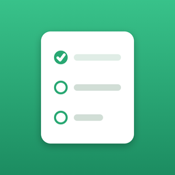
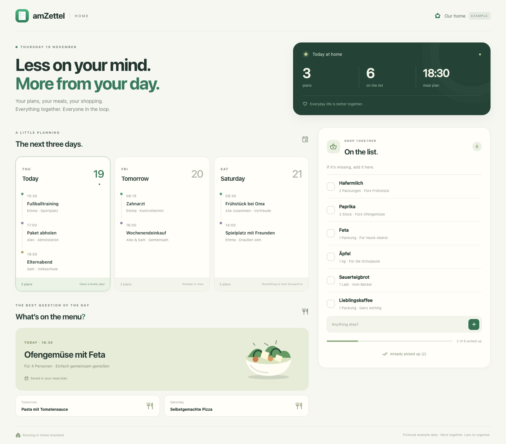

# amZettel for Home Assistant

**English** · [Deutsch](README.de.md)

Bring your **amZettel** shopping lists, tasks, calendars and meal plans into Home Assistant:
on your dashboard, through Assist, or as building blocks for automations and Node-RED.
The integration connects to `app.amzettel.at` over REST/SSE v1.
Changes arrive via SSE; HA catches up after a disconnect.

## A dashboard to make your own



Three days of plans, meals and an interactive shopping list in one view.
The **[optional dashboard template](examples/dashboard/README.md)** includes
English/German controls and copyable YAML. Use your own three entity IDs and
household name; no additional community cards are required.
Your amZettel content keeps its original language. The preview uses fictional data.

## Get started

1. Have **Home Assistant 2026.10.0 or newer** and an amZettel account ready.
2. [Install the integration](docs/installation.md) through **Marketplace** on HA 2026.11+,
   **HACS** on HA 2026.10, or manually.
3. If setup does not open automatically, go to **Settings → Devices & services → Add integration**
   and search for **amZettel**. Follow any HA restart prompt first.
4. Open the displayed link, approve the code using your amZettel account, and select
   which lists, calendars and meal plans should appear.

No API key, client secret or publicly accessible HA address is required.
The **[complete illustrated documentation](docs/README.md)** covers everything
from amZettel sign-in to the HA calendar and automations.

## What you get

| amZettel | Home Assistant | Free | Premium |
|---|---|---|---|
| Shopping lists, checklists, tasks | `todo`: read, add, complete, update, delete | Read and write | Same |
| Calendars | `calendar`: read, create, update and delete events | Read | Read and write |
| Meal plans | `calendar`: read, plus structured queries | Read | Read |

Granted permissions and your membership of each object also apply.
Separate calendars for selected categories are optional.
Meal plans are read-only in this integration, even with Premium.

## Guides

- **[Installation](docs/installation.md):** requirements, Marketplace/HACS, manual copying,
  the illustrated device-code, amZettel sign-in and access-approval flow through to the completed connection,
  updates and removal.
- **[Configuration and use](docs/configuration.md):** permissions, selection, category calendars,
  shared lists, time zones, Assist and meal plans – with calendar and editing screenshots.
- **[Actions and events](docs/actions.md):** fields, response data, synchronization and limitations.
- **[Examples](docs/examples.md):** voice-controlled shopping lists, calendar imports,
  waste-collection reminders, meal plans and Node-RED.
- **[Troubleshooting](docs/troubleshooting.md):** missing integration, expired sign-in,
  permissions, connectivity and diagnostics.
- **[Release notes](docs/release-notes.md):** versioned changes and known limitations.

## Actions

| Action | Purpose |
|---|---|
| `amzettel.add_item` | Add a list item with quantity, unit, category and note |
| `amzettel.add_event` | Add an event with an optional time zone and stable `external_id` to prevent duplicates |
| `amzettel.sync_events` | Synchronize a source's events; removes only events proven to belong to that source within the period |
| `amzettel.get_items` | Query list items, optionally including completed items |
| `amzettel.get_events` | Query events for a period, with recurring series expanded |
| `amzettel.get_meals` | Query planned meals with dishes, time information and number of people |

Supported standard `todo` and `calendar` actions also work.
Individual occurrences of a recurring series cannot be edited separately, only the entire series.
See the [action reference](docs/actions.md) for details and other limitations.

## Development

```sh
uv venv --python 3.14 .local/venv
uv pip install --python .local/venv/bin/python -r requirements_test.txt
PYTHONPYCACHEPREFIX="$PWD/.local/cache/pycache" .local/venv/bin/python -m pytest -q
```

Git ignores all of `.local/`. Keep local environments, caches and internal working
documents there; they belong neither in the repository nor in HA.

The optional dashboard tests use Node.js 22 or later:

```sh
node --test examples/dashboard/tests/*.test.mjs
```

CI checks pytest, dashboard tests, hassfest and HACS. Icons and logos are bundled locally:
[image provenance and validation](docs/branding.md).

## License and security

The integration code, tests and documentation are licensed under [MIT](LICENSE).
You are welcome to use, modify and redistribute them; retain the copyright and license notice.
Copyright © 2026 COCOAR e.U. See [NOTICE](NOTICE) for the license scope.

Bundled amZettel brand assets have [separate terms](TRADEMARK.md).
They may be redistributed unchanged with the integration, including modified versions;
no general brand license is granted. This does not change the license of the amZettel app or service.

Please report security vulnerabilities privately as described in [SECURITY.md](SECURITY.md).
