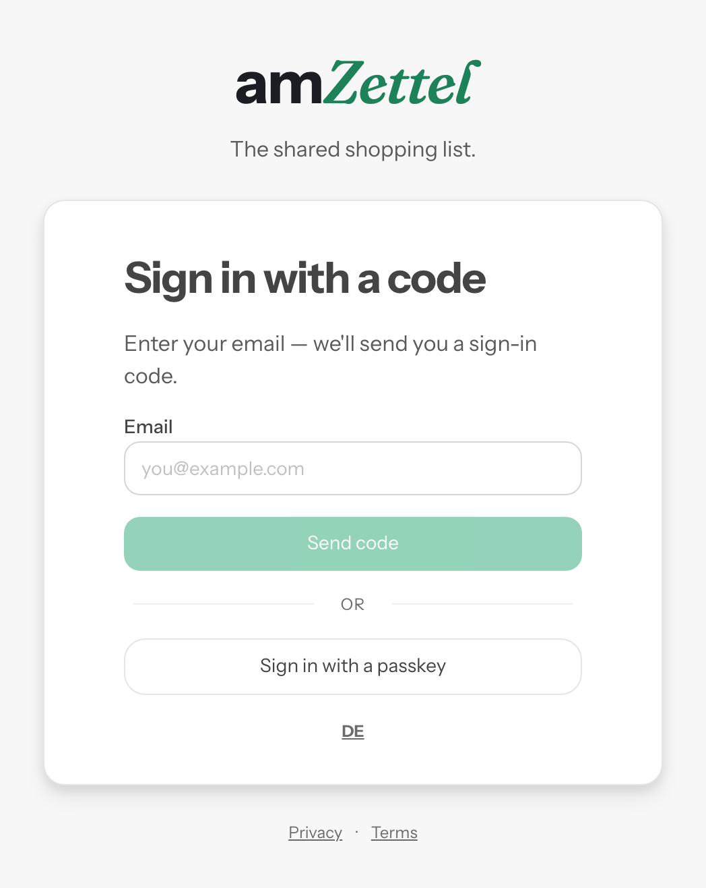
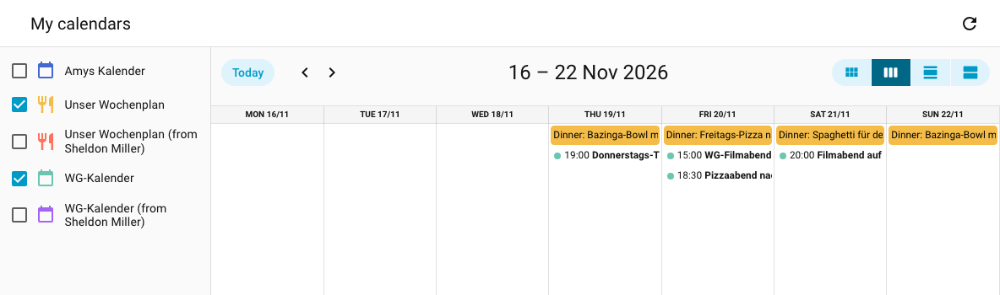

# amZettel for Home Assistant – documentation

**English** · [Deutsch](de/README.md) · [Project overview](../README.md)

This is the complete guide with genuine screenshots from Home Assistant and the
amZettel sign-in page. Start with installation; the usage guide then covers calendars,
event editing, shared lists and meal plans.

## All chapters

| Chapter | Contents |
|---|---|
| [Installation and connection](installation.md) | Marketplace from HA 2026.11, HACS on HA 2026.10, manual installation, amZettel sign-in, access approval, selection and removal |
| [Configuration and use](configuration.md) | Calendar screenshots, moving events, Free/Premium, lists, meal plans and Assist |
| [Actions and events](actions.md) | Action fields, responses, synchronization and limitations |
| [Examples](examples.md) | Shopping lists, calendar imports, waste reminders, meal plans and Node-RED |
| [Troubleshooting](troubleshooting.md) | Sign-in, permissions, missing objects, time zones and diagnostics |
| [Release notes](release-notes.md) | Features and known limitations |

## The amZettel sign-in page

The sign-in page offers an e-mail code or passkey. The subsequent **device approval**
is a separate step, not another sign-in form.
The [installation guide](installation.md#4-sign-in-to-amzettel) covers the entire flow.

## The calendar in HA

The [usage guide](configuration.md#move-events-and-check-synchronization) shows this
calendar, event details, editing and the saved result.

The connection and usage screenshots were taken on November 18, 2026 using HA 2026.10.4, the official
amZettel servers, dedicated demo accounts and demo objects. Addresses, account titles
and access codes are covered; e-mail-code fields are empty. Both languages show the
same steps in their respective interface language; demo objects keep their German names.
The Marketplace screenshot was captured with HA 2026.11.2 and is shared by both guides
in its original German interface.

## For maintainers

[Brand image provenance and validation](branding.md)

This chapter covers the technical integration of brand images, not setup in HA.
