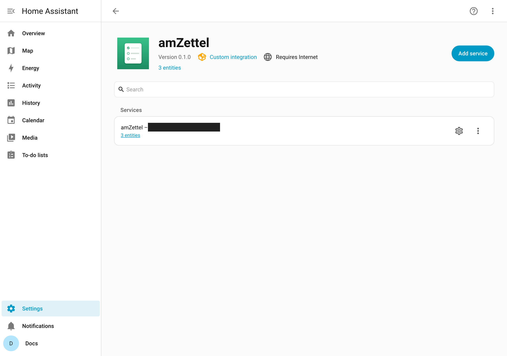

# Brand images

**English** · [Deutsch](de/branding.md)

[Documentation overview](README.md)

## Provenance

These images use the existing **green amZettel app icon** with a white note,
not a new symbol or the different, older handbook favicon.

Source in the amZettel product repository:

```text
src/ios/AmZettel/Assets.xcassets/AppIcon.appiconset/AppIcon.png
```

The original is 1024 × 1024 pixels. It was proportionally resized with Lanczos to the two
target sizes and saved as RGBA PNG without copying the original's metadata.
Colors and shape are unchanged.

## Files

| File under `custom_components/amzettel/brand/` | Size |
|---|---|
| `icon.png` | 256 × 256 |
| `icon@2x.png` | 512 × 512 |
| `logo.png` | 256 × 256 |
| `logo@2x.png` | 512 × 512 |

Icon and logo use the same existing square brand mark.
No new wordmark was created.
The image has its own green background and works in light and dark interfaces.
HA uses its built-in fallback to these images for `dark_icon`/`dark_logo`.

## Integration and validation

HA 2026.3 and newer recognizes a local `brand` folder without an additional manifest setting.
Our minimum supported version, 2026.10.0, meets that requirement.
Include the files when installing manually.

The tests in `tests/test_brand.py` check image sizes and actual delivery through HA's
local Brands API, including dark/HiDPI fallbacks.
The HACS CI no longer skips brand validation.

HACS 2.0.5 still loads repository-list icons from the old central CDN and may show
an “icon not available” placeholder despite correctly installed local images.
This does not indicate a broken integration. Marketplace on HA 2026.11+ uses the
local images correctly; see [installation](installation.md#marketplace).

To check the images in a running HA instance:

1. After installing the images, **restart HA** so integration metadata is reloaded.
2. Reload the browser page.
3. Check the amZettel logo under **Devices & services**.

The integration in our HA test instance (English interface):



A missing or cached image is not a reason to remove the integration or its sign-in.
The image API requires HA authentication; an unauthenticated URL request does not prove the image is missing.

## License and permitted use

The integration code, tests and documentation use the MIT License.
The brand images belong to COCOAR e.U. and are excluded from that license.
They may be redistributed unchanged with the integration and its documentation,
including modified integration versions, to identify compatibility with amZettel.
The full asset terms and rules for names and logos are in the [brand policy](../TRADEMARK.md).

Official references:

- [Local brand images for custom integrations][local]
- [Requirements for HACS integrations][hacs]

[local]: https://developers.home-assistant.io/blog/2026/02/24/brands-proxy-api/
[hacs]: https://www.hacs.xyz/docs/publish/integration/
