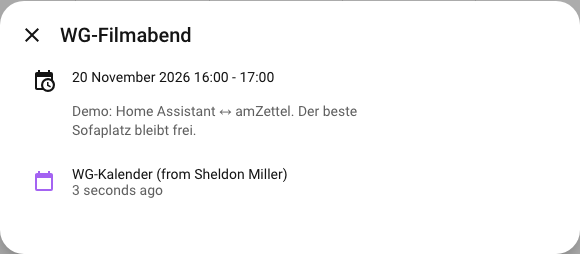
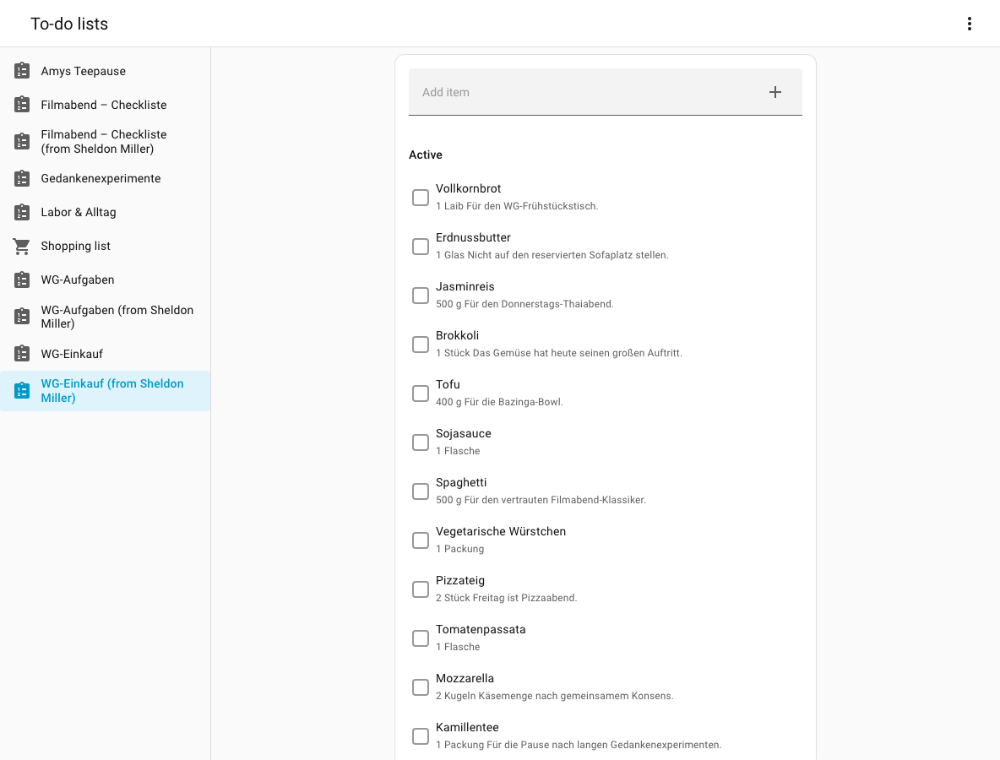
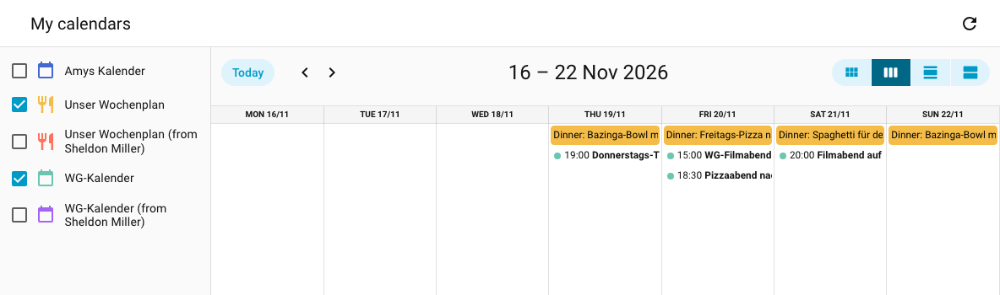
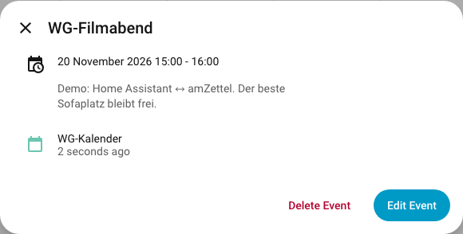
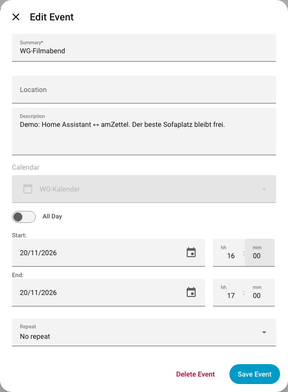
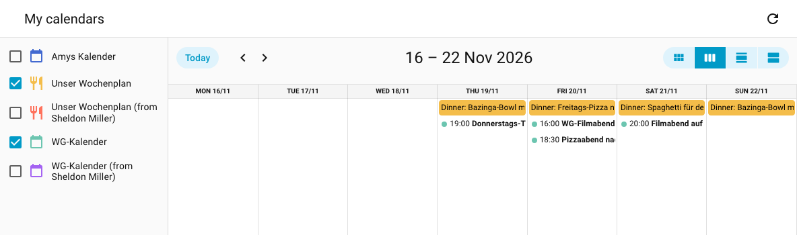
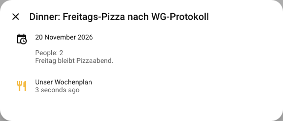

# Configuration and use

**English** · [Deutsch](de/configuration.md)

[Documentation overview](README.md) · [Installation](installation.md)

## Which permissions does HA need?

Choose areas when connecting. Write permissions include the corresponding read permission.

| Area in the dialog | What HA can do |
|---|---|
| Read lists | Display and query shopping lists, checklists and tasks |
| Change lists | Add, edit, complete/buy and delete items |
| Read calendars | Display and query calendar events |
| Change calendars | Create, edit and delete events; requires Premium |
| Read meal plans | Display meals and query structured meal data |

The integration can only access objects your amZettel account can access.
You can further restrict access in amZettel under **Profile → Connected systems**.
Selecting visible objects in HA is a display/integration choice, not an additional server-side permission.

Free can read and change lists, and read calendars and meal plans. Changing calendar events
requires Premium. The production screenshots compare two separate demo connections:
Sheldon with Premium and Amy with Free. The Free calendar has no editing button,
even though calendar writing was requested when connecting.

## Visible lists, calendars and meal plans

The integration entry identifies the signed-in account using its e-mail address confirmed by
amZettel, or its display name if no e-mail is available. Full refreshes and reauthentication update
the account label. Custom entry titles are preserved; **Configure** shows the account regardless
of the title. Object/entity IDs and permissions do not change. Only one account label is stored,
not the full profile; diagnostics redact it.

Under **Settings → Devices & services → amZettel → Configure**:

- Select the **lists**, **calendars** and **meal plans** you want.
- Enable **Add new lists, calendars and meal plans automatically** if objects added later should appear automatically.
  This is enabled by default.
- Save. The integration reloads; deselected entities disappear from HA.

Deselected objects remain unchanged in amZettel. Before deselecting one, check whether an automation,
script, dashboard card or Node-RED flow still references its entity.
The integration emits events only for visible objects.

## Separate calendars for selected categories

Under **Configure → Own calendar for these categories**, select individual categories,
for example **Household · Waste**. Only categories with names are offered.

- A selected category gets its own calendar entity.
- Its events appear **only there**, not in the main calendar.
- All other categories stay in the main calendar.
- Deselecting or deleting a category returns its events to the main calendar.
- A new event created through a category calendar receives that category.

This is optional: a calendar with ten categories does not automatically create ten extra calendars.
Separate entities allow separate display and targeted calendar triggers in automations.
The integration does not transmit amZettel's category colors as a color for each individual HA event.

**Query difference:** the custom `amzettel.get_events` action on the main calendar returns all
categories so structured queries remain complete. On a category calendar it returns only that category.
The normal calendar display and `calendar.get_events`, in contrast, respect the split.

## Distinguish shared lists

Shared entities have a suffix, for example **WG-Einkauf (shared)**;
in German HA uses **(geteilt)**. If amZettel supplies the owner's name,
the suffix is instead, for example, **(from Anna)**. Your own objects have no suffix.

Renaming does not change the amZettel ID. Entities with identical names still receive different HA
entity IDs. Voice commands may be ambiguous when lists share a name; use a unique name or a suitable
alias in HA.

In the example, Amy uses **WG-Einkauf**, shared by Sheldon. Her Free account can add
and buy items through HA. Sheldon sees the same list without an owner suffix.

## Time and time zones

Check the HA time zone under **Settings → System → General**, for example `Europe/Vienna`.
The operating system's or container's `TZ` variable does not replace this setting.

- Normal creation through the HA calendar uses the HA installation's time zone.
- `amzettel.add_event` can explicitly select another zone using `time_zone`.
- Without an offset, a clock time belongs to the selected zone. With an offset, the given instant
  is converted to that zone; it is not reinterpreted as a new local clock time.
- All-day events store dates only, without a time or zone.

UTC is valid. amZettel stores clock time and zone together; the editor shows the stored zone.
Recurring 09:00 UTC events therefore have a different local time in Vienna in summer than in winter.
See the [action reference](actions.md#time-zones-and-date-boundaries) for examples.

## Try Assist

1. Open the Assist dialog in HA, usually through the Assist/speech-bubble icon.
2. Use the local **Home Assistant conversation agent** and choose **English**.
3. Start by typing:

   > Add milk to the Weekly shopping list.

4. To complete an item:

   > Complete milk on the Weekly shopping list.

Use your list's actual name. On a shopping list this buys the item; on a checklist or task list
it marks it as completed. Completing tasks preserves notes and due dates.
Quantity and unit appear in the description so the item's matching name remains “Milk.”

Without an unambiguous list name, a sentence may match HA's own shopping list.
If an item ends up there instead of in amZettel, see
[troubleshooting](troubleshooting.md#assist-cannot-find-the-list).
Enable the entity for Assist if HA asks for it.

You do not need a microphone for a typed test. Spoken commands additionally require
a suitable HA voice pipeline and input device.
**Alexa is not connected automatically:** the integration provides to-do entities, but does not
include an Alexa skill or automatic access to Alexa's own shopping list.

## Move events and check synchronization

These production screenshots use a separate local test instance with HA's time zone set to
`Europe/Vienna`. Other HA zones can display a different local time.
Only new example objects were created for this test.

1. Enable the relevant calendar under **Calendar**. The example **WG-Filmabend** starts
   at 15:00 on November 20, 2026 in the Premium account's **WG-Kalender**.

   

2. Open the event and choose **Edit event**.

   

3. Change its start and end, here to **16:00–17:00**, then choose **Save event**.
   This example edits a single event, not one occurrence of a series.

   

4. Check the new time in HA and in the amZettel app using the same account.
   An independent backend read confirmed **16:00–17:00 Europe/Vienna** in this test.
   Changes from amZettel return through realtime updates; see
   [troubleshooting](troubleshooting.md) if the connection is interrupted.

   

Meal-plan calendars remain read-only and have no editing action.

## Meal plans

Each selected meal plan becomes a **read-only calendar**.

| Entry in amZettel | In HA |
|---|---|
| Stored meal time and time zone (`PlannedTime`/`PlannedZone`) | Point in time without duration, converted to HA's zone for display |
| Named time without a stored instant, such as “Lunch” or “School snack” | All-day event with the time-of-day name and dishes in the title |
| Legacy exact time without a snapshot (`ExactTime`/`Time`) | As before in HA's zone, with a calendar duration of 60 minutes |
| No time specified | All-day |
| Number of people and note | Description |
| “Show in calendar” off | Not shown in the calendar |

The time and zone stored on the meal are authoritative.
Later changes to slot times, slot order or the plan's zone do not move existing meals.
Without a snapshot, no time is inferred from today's template or `SortMinutes`.
`amzettel.get_meals` also returns meals hidden from the calendar, with a flag,
instead of hiding them from structured queries.

The example **Freitags-Pizza nach WG-Protokoll** appears all-day on November 20, 2026:

The separate server feature for meal-plan start times was not enabled during capture,
so the demo meals have no stored instant. This is not an HA error.
A stored instant would appear without duration, for example as **18:00–18:00**.
The HA meal-plan calendar remains read-only, regardless of the time or subscription.

## Interface language

Custom dialogs and actions are available in German and English.
HA may use different languages for the user profile and system-wide configuration.
Check both settings if labels appear in an unexpected language.
