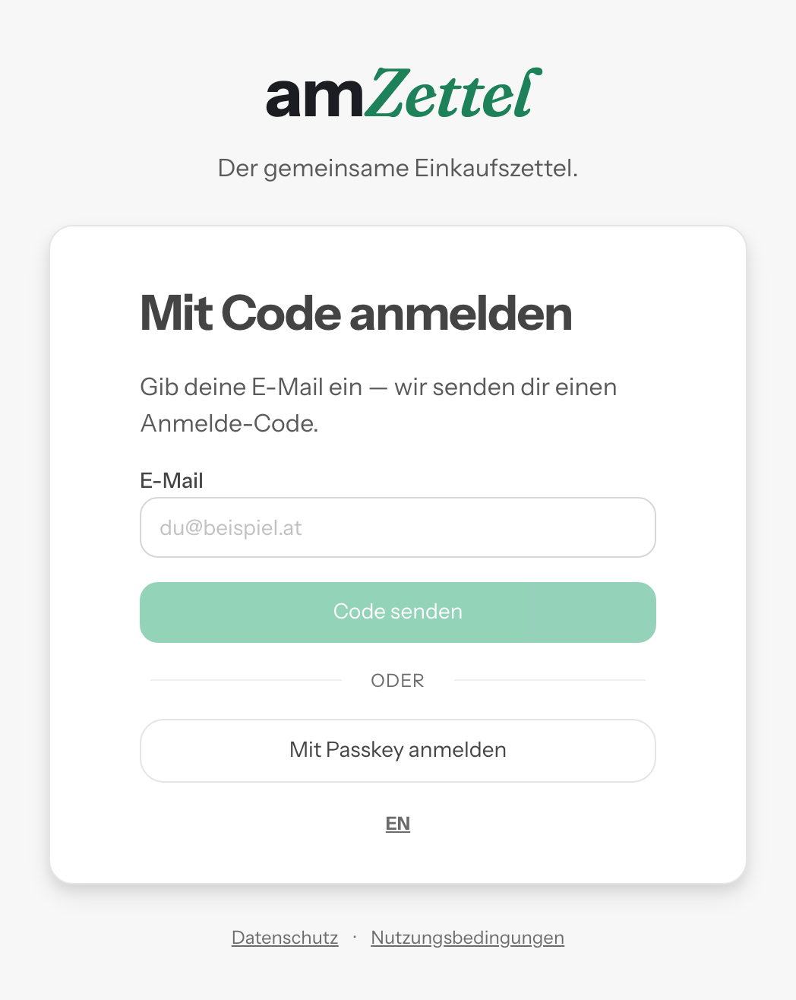
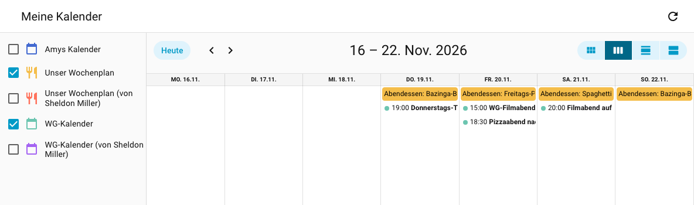

# amZettel für Home Assistant – Dokumentation

[English](../README.md) · **Deutsch** · [Projektübersicht](../../README.de.md)

Hier findest du die vollständige Anleitung mit echten Bildern aus Home Assistant
und der amZettel-Anmeldung. Beginne mit der Installation; die Bedienung zeigt danach
Kalender, Terminbearbeitung, geteilte Zettel und Essenspläne.

## Alle Kapitel

| Kapitel | Inhalt |
|---|---|
| [Installation und Verbindung](installation.md) | HACS/Marketplace, manuelles Installieren, amZettel-Anmeldung, Zugriffsfreigabe, Auswahl und Entfernen |
| [Einrichtung und Bedienung](configuration.md) | Kalenderbilder, Termine verschieben, Free/Premium, Zettel, Essenspläne und Assist |
| [Aktionen und Ereignisse](actions.md) | Aktionsfelder, Antworten, Synchronisation und Grenzen |
| [Beispiele](examples.md) | Einkaufszettel, Kalenderimport, Müll-Erinnerung, Essensplan und Node-RED |
| [Fehlerhilfe](troubleshooting.md) | Anmeldung, Rechte, fehlende Objekte, Zeitzonen und Diagnose |
| [Release-Notizen](release-notes.md) | Funktionsumfang und bekannte Einschränkungen |

## So sieht die amZettel-Anmeldung aus

Die Anmeldemaske bietet E-Mail-Code und Passkey. Die anschließende
**Gerätefreigabe** ist ein eigener Schritt, keine weitere Loginmaske.
Die [Installationsanleitung](installation.md#4-bei-amzettel-anmelden) zeigt den ganzen Ablauf.

## So sieht der Kalender in HA aus

Die [Bedienungsanleitung](configuration.md#termine-verschieben-und-abgleichen)
zeigt diesen Kalender, die Termindetails, das Verschieben und das gespeicherte Ergebnis.

Die Bilder stammen vom 18. November 2026: HA 2026.10.4, offizielle amZettel-Server,
eigens angelegte Demokonten und Demoobjekte. Adressen, Kontotitel und Zugangscodes
sind abgedeckt; E-Mail-Codefelder sind leer. Die englische Anleitung zeigt dieselben
Schritte mit englischer Oberfläche, die Demoobjekte behalten ihre deutschen Namen.

## Für Maintainer

[Herkunft und Prüfung der Markenbilder](branding.md)

Dieses Kapitel betrifft die technische Einbindung der Markenbilder, nicht die Einrichtung in HA.
