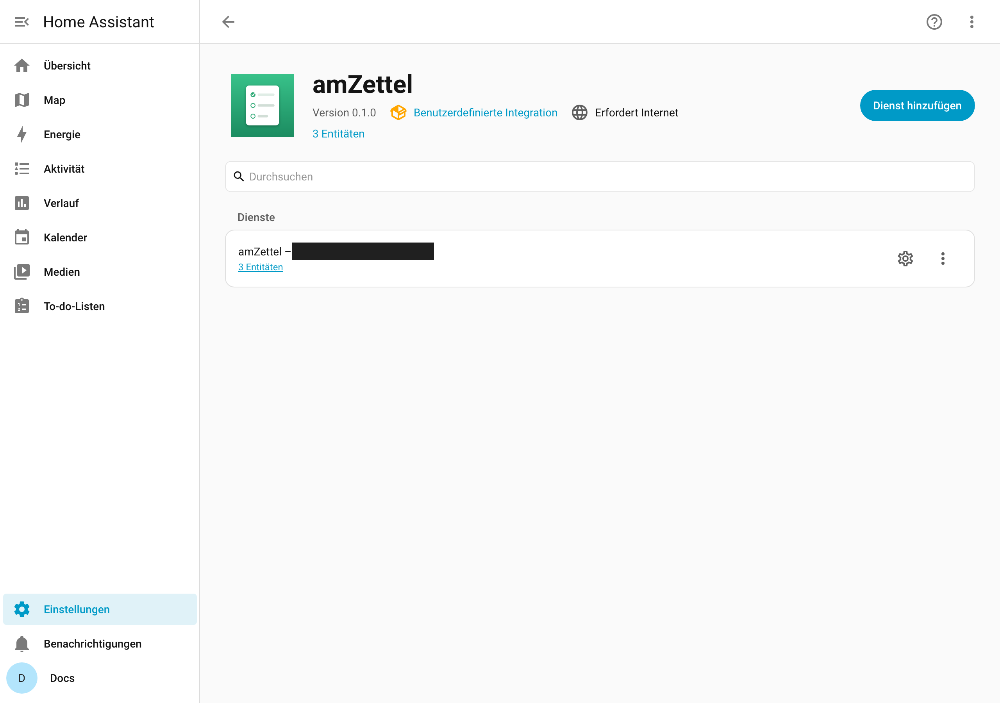

# Brand-Bilder

[English](../branding.md) · **Deutsch**

[Dokumentationsübersicht](README.md)

## Herkunft

Verwendet wird das vorhandene **grüne amZettel-App-Icon** mit dem weißen Zettel,
nicht ein neues Zeichen und nicht das abweichende ältere Handbuch-Favicon.

Quelle im amZettel-Produktrepository:

```text
src/ios/AmZettel/Assets.xcassets/AppIcon.appiconset/AppIcon.png
```

Das Original ist 1024 × 1024 Pixel groß. Es wurde proportional mit Lanczos auf die beiden
Zielgrößen verkleinert und als RGBA-PNG gespeichert, ohne Metadaten des Originals zu übernehmen.
Farben und Form sind unverändert.

## Dateien

| Datei unter `custom_components/amzettel/brand/` | Größe |
|---|---|
| `icon.png` | 256 × 256 |
| `icon@2x.png` | 512 × 512 |
| `logo.png` | 256 × 256 |
| `logo@2x.png` | 512 × 512 |

Icon und Logo verwenden dasselbe vorhandene quadratische Markenzeichen.
Es wurde keine neue Wortmarke erzeugt.
Das Motiv hat einen eigenen grünen Hintergrund und funktioniert in heller und dunkler Umgebung.
Für `dark_icon`/`dark_logo` nutzt HA seinen vorgesehenen Fallback auf diese Bilder.

## Einbindung und Prüfung

HA ab 2026.3 erkennt den lokalen `brand`-Ordner ohne zusätzliche Manifest-Einstellung.
Unsere Mindestversion 2026.10.0 erfüllt das.
Die Dateien müssen bei manueller Installation mitkopiert werden.

Die Tests in `tests/test_brand.py` prüfen Größen sowie das tatsächliche Ausliefern über
HAs lokale Brands-API einschließlich der Dark-/HiDPI-Fallbacks.
Die HACS-CI überspringt die Brands-Prüfung nicht mehr.

Für die Kontrolle in einer laufenden HA-Instanz:

1. Nach Installation der Bilder **HA neu starten**, damit die Integrationsmetadaten neu eingelesen werden.
2. Die Browserseite neu laden.
3. Unter **Geräte & Dienste** das amZettel-Logo kontrollieren.

So erscheint die Integration in unserer HA-Testinstanz:



Ein fehlendes oder zwischengespeichertes Bild ist kein Grund, die Integration oder ihre Anmeldung
zu löschen. Die Bild-API verlangt eine HA-Anmeldung; eine nicht angemeldete URL-Abfrage ist kein
Nachweis, dass das Bild fehlt.

## Lizenz und erlaubte Verwendung

Integrationscode, Tests und Dokumentation stehen unter der MIT-Lizenz.
Die Markenbilder gehören COCOAR e.U. und sind von dieser Lizenz ausgenommen.
Sie dürfen unverändert mit der Integration und ihrer Dokumentation weitergegeben werden,
auch mit angepassten Integrationsversionen, um die Kompatibilität mit amZettel kenntlich zu machen.
Die vollständigen Bildbedingungen und Regeln für Namen und Logos stehen in der [Markenregelung](../../TRADEMARK.md).

Offizielle Referenzen:

- [Lokale Brand-Bilder für Custom-Integrationen][local]
- [Anforderungen an HACS-Integrationen][hacs]

[local]: https://developers.home-assistant.io/blog/2026/02/24/brands-proxy-api/
[hacs]: https://www.hacs.xyz/docs/publish/integration/
