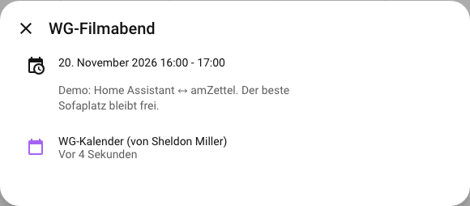
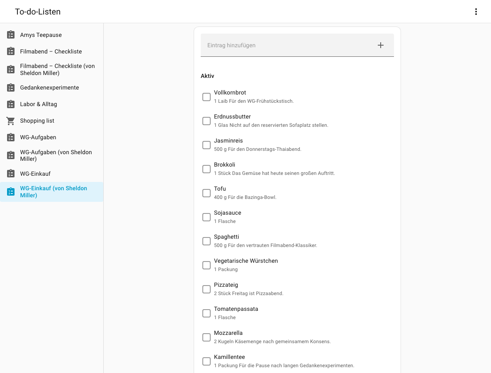
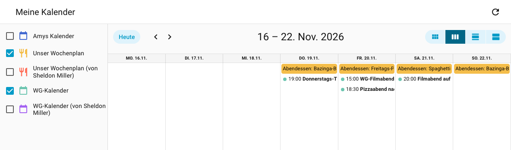
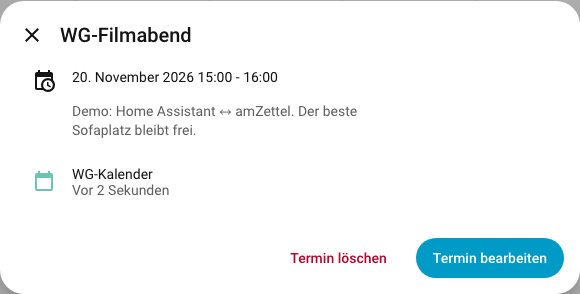
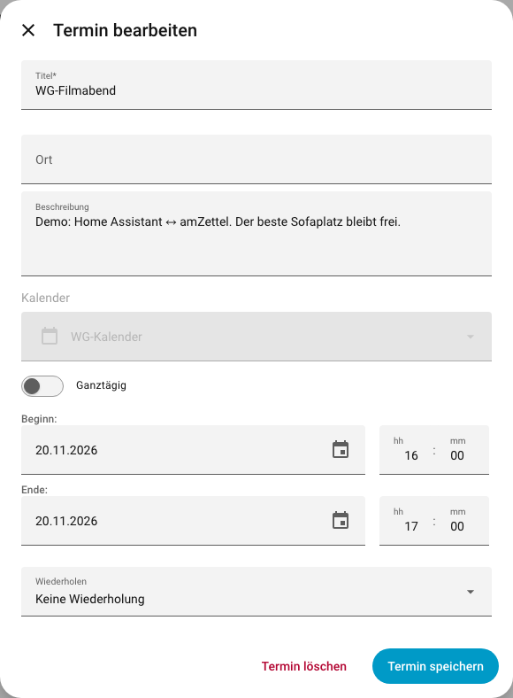
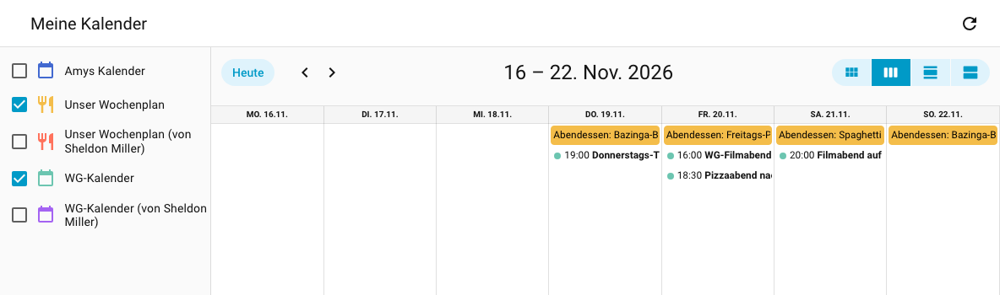
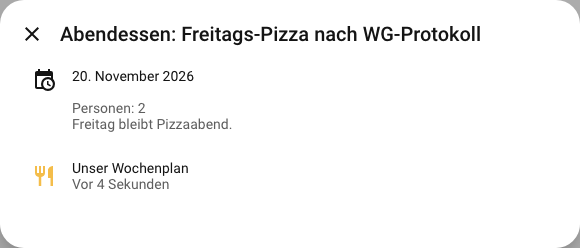

# Einrichtung und Bedienung

[English](../configuration.md) · **Deutsch**

[Dokumentationsübersicht](README.md) · [Installation](installation.md)

## Welche Rechte braucht HA?

Die Bereiche werden beim Verbinden ausgewählt. Schreibrechte schließen das passende Leserecht ein.

| Bereich im Dialog | Damit kann HA |
|---|---|
| Zettel lesen | Einkauf, Checklisten und Aufgaben anzeigen und abfragen |
| Zettel ändern | Einträge hinzufügen, ändern, abhaken/kaufen und löschen |
| Kalender lesen | Kalendertermine anzeigen und abfragen |
| Kalender ändern | Termine anlegen, ändern und löschen; Premium erforderlich |
| Essenspläne lesen | Mahlzeiten anzeigen und strukturiert abfragen |

Die Integration kann nur auf Objekte zugreifen, auf die dein amZettel-Konto selbst Zugriff hat.
Unter **Profil → Verbundene Systeme** in amZettel lässt sich der Zugriff zusätzlich einschränken.
Die Auswahl sichtbarer Objekte in HA ist eine Darstellungs-/Integrationsauswahl, keine zusätzliche
serverseitige Berechtigung.

Mit Free sind Zettel les- und schreibbar; Kalender und Essenspläne bleiben lesbar.
Kalender ändern braucht Premium. Die folgenden Prod-Aufnahmen vergleichen zwei getrennte
Demoverbindungen: Sheldon mit Premium und Amy mit Free. Beim Free-Kalender fehlt die
Bearbeiten-Schaltfläche, obwohl der Kalender beim Verbinden zum Schreiben freigegeben wurde.

## Sichtbare Zettel, Kalender und Essenspläne

Der Integrationseintrag nennt das tatsächlich angemeldete Konto: seine von amZettel bestätigte
E-Mail-Adresse, ersatzweise den Anzeigenamen. Die Kontobezeichnung wird bei Vollabrufen
und nach erneuter Anmeldung aktualisiert. Selbst vergebene Eintragstitel bleiben erhalten;
unter **Konfigurieren** steht das Konto unabhängig vom Titel. Objekt-/Entity-IDs und
Berechtigungen ändern sich nicht. Gespeichert wird nur eine Kontobezeichnung, kein vollständiges
Profil; Diagnosen schwärzen sie.

Unter **Einstellungen → Geräte & Dienste → amZettel → Konfigurieren**:

- Gewünschte **Zettel**, **Kalender** und **Essenspläne** auswählen.
- **Neue automatisch übernehmen** einschalten, wenn später hinzugefügte Objekte automatisch
  erscheinen sollen. Standardmäßig ist der Schalter an.
- Speichern. Die Integration lädt neu; abgewählte Entitäten verschwinden aus HA.

Abgewählte Objekte bleiben in amZettel unverändert. Prüfe vor dem Abwählen, ob eine Automation,
ein Skript, eine Dashboard-Karte oder Node-RED noch auf die Entität verweist.
Die Ereignisse der Integration werden nur für sichtbare Objekte erzeugt.

## Eigene Kalender für einzelne Kategorien

In **Konfigurieren → Eigener Kalender für diese Kategorien** gezielt einzelne Kategorien auswählen,
zum Beispiel **Haushalt · Müll**. Es werden nur Kategorien mit Namen angeboten.

- Eine ausgewählte Kategorie bekommt eine eigene Kalender-Entität.
- Ihre Termine erscheinen **nur dort**, nicht mehr im Hauptkalender.
- Alle anderen Kategorien bleiben im Hauptkalender.
- Beim Abwählen oder Löschen der Kategorie fallen ihre Termine in den Hauptkalender zurück.
- Ein neuer Termin, der über den Kategorie-Kalender angelegt wird, erhält dessen Kategorie.

Das ist freiwillig: Ein Kalender mit zehn Kategorien erzeugt nicht automatisch zehn zusätzliche
Kalender. Die Entitäten ermöglichen getrennte Anzeige und gezielte Kalender-Auslöser in Automationen.
Die Integration überträgt amZettels Kategorienfarben nicht als Farbe jedes einzelnen HA-Termins.

**Unterschied bei Abfragen:** Die eigene Aktion `amzettel.get_events` liefert auf dem Hauptkalender
alle Kategorien, damit strukturierte Abfragen vollständig bleiben. Auf einem Kategorie-Kalender
liefert sie nur dessen Kategorie. Die normale Kalenderanzeige und `calendar.get_events`
berücksichtigen dagegen die Aufteilung.

## Geteilte Zettel unterscheiden

Geteilte Entitäten tragen einen Zusatz, beispielsweise **WG-Einkauf (geteilt)**;
bei englischer HA-Sprache **(shared)**. Falls amZettel den Besitzernamen mitliefert,
steht stattdessen beispielsweise **(von Anna)**. Eigene Objekte haben keinen Zusatz.

Eine Umbenennung ändert nicht die amZettel-Id. Gleich benannte Entitäten bekommen in HA dennoch
unterschiedliche Entitäts-IDs. Für Sprache können gleich benannte Listen mehrdeutig sein; verwende
einen eindeutigen Namen oder einen passenden Alias in HA.

Im Beispiel nutzt Amy den von Sheldon geteilten **WG-Einkauf**. Auch mit Free kann sie
dort Artikel über HA hinzufügen und kaufen. Dasselbe Objekt erscheint bei Sheldon ohne Zusatz.

## Zeit und Zeitzone

Die HA-Zeitzone unter **Einstellungen → System → Allgemein** überprüfen, beispielsweise
`Europe/Vienna`. Die System- oder Container-Variable `TZ` ersetzt diese Einstellung nicht.

- Normales Eintragen über den HA-Kalender nutzt die Zeitzone der HA-Installation.
- `amzettel.add_event` kann mit `time_zone` ausdrücklich eine andere Zone angeben.
- Ohne Offset gehört eine Uhrzeit zur gewählten Zone. Mit Offset wird der angegebene Zeitpunkt
  in diese Zone umgerechnet; er wird nicht als neue Ortszeit interpretiert.
- Ganztägige Termine speichern nur Daten, keine Uhrzeit und keine Zone.

UTC ist gültig. In amZettel bleiben Uhrzeit und Zone gemeinsam gespeichert; der Editor zeigt die
gespeicherte Zone. Wiederkehrende 09:00 UTC sind daher im Wiener Sommer nicht dieselbe örtliche
Uhrzeit wie im Winter. Die [Aktionsreferenz](actions.md#zeitzonen-und-datumsgrenzen) enthält Beispiele.

## Assist ausprobieren

1. In HA den Assist-Dialog öffnen (je nach Oberfläche das Assist-/Sprechblasensymbol).
2. Den lokalen **Home-Assistant-Sprachassistenten** verwenden und Sprache **Deutsch** wählen.
3. Zunächst tippen:

   > Setze Milch auf die Liste Wocheneinkauf.

4. Zum Abhaken:

   > Hake Milch auf der Liste Wocheneinkauf ab.

Verwende den tatsächlichen Namen deiner Liste. Ein Einkaufszettel kauft den Eintrag, eine Checkliste
oder Aufgabenliste markiert ihn als erledigt. Bei Aufgaben bleiben dabei Notiz und Fälligkeit erhalten.
Menge und Einheit stehen in der Beschreibung, damit der Name beim Sprachabgleich „Milch“ bleibt.

Ohne eindeutigen Listennamen kann ein Satz auf HAs eigene Einkaufsliste passen. Wenn dort statt
in amZettel etwas landet, siehe [Fehlerhilfe](troubleshooting.md#assist-findet-die-liste-nicht).
Sollte HA eine Freigabe für Assist verlangen, diese bei der Entität aktivieren.

Ein Mikrofon ist für den getippten Test nicht nötig. Für gesprochene Befehle braucht HA zusätzlich
eine passende Sprach-Pipeline und ein Eingabegerät.
**Alexa ist nicht automatisch verbunden:** Die Integration stellt To-do-Entitäten bereit,
enthält aber keinen Alexa-Skill und keine automatische Anbindung an Alexas eigene Einkaufsliste.

## Termine verschieben und abgleichen

Die folgenden Prod-Aufnahmen stammen aus einer getrennten lokalen HA-Testinstanz mit HA-Zone
`Europe/Vienna`. Bei einer anderen HA-Zone kann die angezeigte Ortszeit abweichen.
Für diesen Test wurden nur neue Beispielobjekte angelegt.

1. Unter **Kalender** den gewünschten Kalender aktivieren. Im Beispiel liegt der
   **WG-Filmabend** am 20. November 2026 um 15 Uhr im **WG-Kalender** des Premium-Kontos.

   

2. Den Termin öffnen und **Termin bearbeiten** wählen.

   

3. Beginn und Ende ändern, hier auf **16:00–17:00**, dann **Termin speichern** wählen.
   Das Beispiel bearbeitet einen einzelnen Termin, nicht ein Vorkommen einer Serie.

   

4. Die neue Zeit in HA und anschließend in der amZettel-App mit demselben Konto prüfen.
   Der unabhängige Backend-Abruf bestätigte im Test **16:00–17:00 Europe/Vienna**.
   Änderungen aus amZettel kommen per Realtime zurück; bei Verbindungsproblemen hilft
   die [Fehlerhilfe](troubleshooting.md).

   

Essensplan-Kalender sind dagegen nur lesend: Dort gibt es keine Aktion zum Bearbeiten.

## Essensplan

Jeder ausgewählte Essensplan wird ein **nur lesender Kalender**.

| Eintrag in amZettel | In HA |
|---|---|
| Gespeicherte Mahlzeitenzeit und Zeitzone (`PlannedTime`/`PlannedZone`) | Zeitpunkt ohne Dauer, zur Anzeige in die HA-Zone umgerechnet |
| Benannte Zeit ohne gespeicherten Zeitpunkt, etwa „Mittagessen“ oder „Schuljause“ | Ganztägiger Termin mit benannter Zeit und Gerichten im Titel |
| Alte genaue Uhrzeit ohne Snapshot (`ExactTime`/`Time`) | Wie bisher in der HA-Zone, Kalenderdauer 60 Minuten |
| Keine Zeitangabe | Ganztägig |
| Personenzahl und Notiz | Beschreibung |
| „Im Kalender zeigen“ aus | Nicht im Kalender |

Maßgeblich sind die an der Mahlzeit gespeicherte Uhrzeit und Zeitzone.
Spätere Änderungen an Slot-Uhrzeiten, Slot-Reihenfolge oder Plan-Zone verschieben bestehende Mahlzeiten nicht.
Ohne Snapshot wird keine Uhrzeit aus der heutigen Vorlage oder `SortMinutes` abgeleitet.
`amzettel.get_meals` liefert auch im Kalender ausgeblendete Mahlzeiten mit Kennzeichen,
statt sie für strukturierte Abfragen zu verschweigen.

Im Beispiel erscheint **Freitags-Pizza nach WG-Protokoll** am 20. November 2026 ganztägig:

Die separate Serverfunktion für Essensplan-Uhrzeiten war bei der Aufnahme nicht aktiviert;
die Demomahlzeiten besitzen daher keinen gespeicherten Zeitpunkt. Das ist kein HA-Fehler.
Ein gespeicherter Zeitpunkt würde ohne Dauer angezeigt, etwa als **18:00–18:00**.
Der HA-Essensplan bleibt unabhängig von Uhrzeit und Tarif nur lesend.

## Sprache der Oberfläche

Die eigenen Dialoge und Aktionen sind auf Deutsch und Englisch vorhanden. HA kann die Sprache des
Benutzerprofils und die systemweite Sprache unterschiedlich verwenden. Bei unerwartet englischen
Beschriftungen beide Einstellungen prüfen.
