# Installation und Verbindung

[English](../installation.md) · **Deutsch**

[Dokumentationsübersicht](README.md)

**Ablauf:** [Voraussetzungen](#voraussetzungen) → [Installation](#installation) →
[Mit amZettel verbinden](#verbindung-einrichten) → [Funktion prüfen](#nach-dem-verbinden-praktisch-prüfen).

## Voraussetzungen

- **Home Assistant ab 2026.10.0**, wie in `hacs.json` angegeben.
- Ein **amZettel-Konto**. Zum Lesen und zum Bearbeiten von Zetteln reicht der kostenlose Tarif;
  zum Ändern von Kalenderterminen ist Premium nötig.
- Home Assistant und dein Browser erreichen den amZettel-Server und dessen Anmeldedienst.
- Administratorrechte in Home Assistant, um eine Integration zu installieren.
- Für die Installation über Marketplace/HACS: Zugriff auf dessen Repository-Verwaltung.

Die Integration ist eine **Custom-Integration**, kein Add-on. Sie läuft innerhalb von Home Assistant;
ein zusätzlicher amZettel-Container ist nicht nötig. Für Home Assistant Container ist der manuelle
Installationsweg genauso möglich wie für Home Assistant OS.

## Installation

Wähle den passenden Weg für deine Home-Assistant-Version:

| HA-Version | Installationsweg |
|---|---|
| **Ab 2026.11** | [Marketplace](#marketplace), eingebaut und empfohlen |
| **2026.10** | [HACS](#über-hacs-installieren), separat installiert |
| **Ab 2026.10** | [Manuell installieren](#manuell-installieren), falls gewünscht |

Marketplace und HACS installieren dieselbe Integration. Beide Wege setzen keine Aufnahme
in den offiziellen Katalog voraus: Du kannst das GitHub-Repository selbst hinzufügen.
Community-Integrationen werden vom Home-Assistant-Projekt weder geprüft noch unterstützt.

### Marketplace

Ab **HA 2026.11** ersetzt Marketplace HACS und ist bereits in HA enthalten.
Installiere HACS nicht zusätzlich.

1. **Einstellungen → Marketplace** öffnen.
2. Beim ersten Öffnen den Hinweis zu Community-Inhalten lesen und bestätigen.
3. **Über Link hinzufügen** wählen und GitHub verbinden, falls HA dazu auffordert.
   HA zeigt einen Gerätecode und einen GitHub-Link: Link öffnen, den Code bei Bedarf eingeben
   und die Verbindung freigeben. Nach der Erfolgsbestätigung von GitHub zu HA zurückkehren.
4. Unter **GitHub-Link** die Adresse
   `https://github.com/cocoar-dev/amzettel-homeassistant` eintragen und **Hinzufügen** wählen.
   Falls HA nach dem Inhaltstyp fragt, **Integration** auswählen und erneut **Hinzufügen** wählen.
5. **amZettel** öffnen, **Installieren** wählen, die angebotene Version prüfen
   und die Installation mit **Installieren** bestätigen.
6. Nach der Installation öffnet Marketplace den amZettel-Einrichtungsdialog.
   Mit [Server und Rechte wählen](#2-server-und-rechte-wählen) fortfahren.
   Fordert HA einen Neustart, diesen zuerst durchführen. Öffnet sich der Dialog nicht,
   **Einstellungen → Geräte & Dienste → Integration hinzufügen → amZettel** verwenden.

> [!NOTE]
> Die GitHub-Verbindung erlaubt Marketplace, das Custom Repository herunterzuladen und
> zu aktualisieren. Sie meldet dich **nicht** bei amZettel an. Der weiter unten gezeigte
> amZettel-Device-Code und die Kontofreigabe gehören zu einer eigenen Verbindung.

Die installierte Integration im Marketplace von HA 2026.11.2 (Ausschnitt):

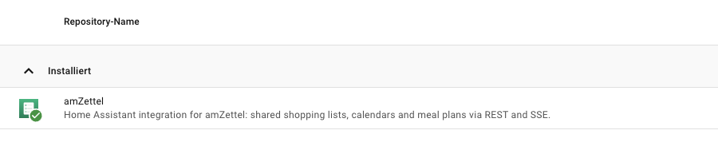

### Über HACS installieren

Für **HA 2026.10** mit eingerichtetem HACS:

1. **HACS** öffnen.
2. Im Menü **⋮ → Benutzerdefinierte Repositories / Custom repositories** die Adresse
   `https://github.com/cocoar-dev/amzettel-homeassistant` eintragen.
3. Als Typ **Integration** wählen und hinzufügen.
4. **amZettel** suchen und die angebotene Version herunterladen.
5. **Home Assistant neu starten**, nicht nur die Seite im Browser.
6. Anschließend [die Verbindung einrichten](#verbindung-einrichten).

Bei einem Platzhalter-Icon in der HACS-Liste helfen die [Brand-Bild-Hinweise](branding.md#einbindung-und-prüfung).

### Von HACS umsteigen

Beim HA-Update auf **2026.11 oder neuer** übernimmt Marketplace automatisch von HACS.
Installierte Inhalte, Custom Repositories und Update-Entitäten bleiben erhalten; HACS selbst
wird entfernt. Öffne danach **Einstellungen → Marketplace**. Du musst amZettel weder
deinstallieren noch seine Dateien neu kopieren oder die Verbindung erneut einrichten.
Weitere Änderungen beschreibt die [offizielle HACS-Migrationsanleitung][migration].

## Manuell installieren

1. Ein Home-Assistant-Backup erstellen.
2. Den Ordner **`custom_components/amzettel`** aus diesem Repository nehmen.
3. Den **gesamten Ordner** in das Konfigurationsverzeichnis von Home Assistant kopieren:
   unter `custom_components/amzettel`.
4. **Home Assistant neu starten.**
5. [Die Verbindung einrichten](#verbindung-einrichten).

Das Konfigurationsverzeichnis ist der Ordner, in dem `configuration.yaml` liegt.
Bei HA OS ist das typischerweise `/config`. In einem Container entspricht `/config`
dem vom Betreiber eingebundenen Host-Verzeichnis.

Die Datei liegt danach beispielsweise unter:

```text
/config/custom_components/amzettel/manifest.json
```

**Nicht** unter `/config/amzettel` und auch nicht unter
`/config/custom_components/amzettel/custom_components/amzettel`.
Kopiere weder `.local` noch alte `.venv`-Ordner, Tests oder Git-Dateien nach `/config`.
Die Unterordner `brand` und `translations` gehören dagegen dazu.

Für eine **Erstinstallation mit Dateizugriff auf den HA-Host** kannst du aus dem entpackten
Quell-/Installationsordner beispielsweise so kopieren. Ersetze den Beispielpfad durch deinen
tatsächlichen Konfigurationsordner:

```sh
HA_CONFIG="/pfad/zur/ha-konfiguration"
mkdir -p "$HA_CONFIG/custom_components"
cp -R custom_components/amzettel "$HA_CONFIG/custom_components/"
```

Über einen Dateimanager oder eine bestehende Freigabe entsprechend den ganzen Ordner kopieren.
Bei einem Update stattdessen den Abschnitt [Aktualisieren](#aktualisieren) beachten.

### Bei einem bestehenden HA-Container

Kopiere den Integrationsordner in den Konfigurationsordner, den dein vorhandener Container
bereits eingebunden hat. Alternativ kann ein zusätzlicher Bind-Mount auf
`/config/custom_components/amzettel` verwendet werden.

Die Integration braucht keine Änderungen an `configuration.yaml`. Eine Neuinstallation von HA,
ein Zurücksetzen des Konfigurationsordners oder ein Löschen bestehender Container ist nicht nötig.

## Verbindung einrichten

Die folgenden **echten Aufnahmen** entstanden mit HA 2026.10.4 und einem eigens
angelegten Demokonto auf `app.amzettel.at`. Die Beispielobjekte heißen
`WG-Einkauf`, `WG-Kalender` und `Unser Wochenplan`.
Konto-Adressen, Zugangscodes und vollständige Device-Links sind geschwärzt.

### 1. Integration suchen

**Einstellungen → Geräte & Dienste → Integration hinzufügen** öffnen, nach **amZettel**
suchen und den Treffer auswählen. Fehlt er, zuerst den [Installationspfad](#manuell-installieren)
und den vollständigen HA-Neustart prüfen.
Hat Marketplace den Einrichtungsdialog bereits geöffnet, direkt mit Schritt 2 fortfahren.

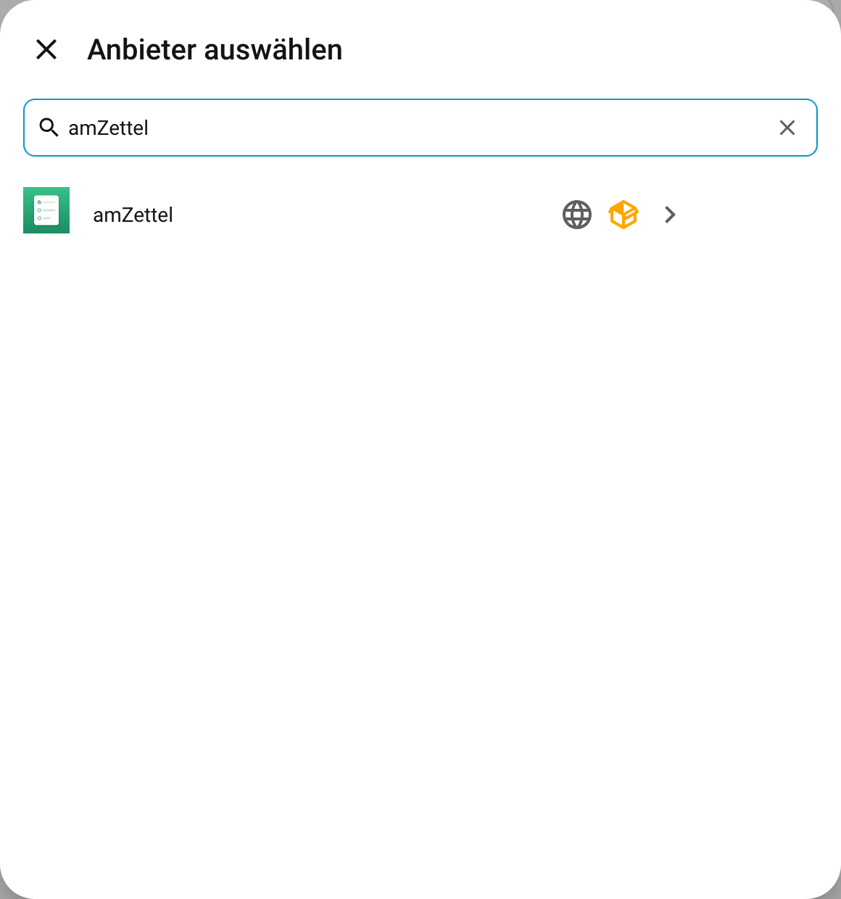

### 2. Server und Rechte wählen

Lass den offiziellen Server `https://app.amzettel.at` voreingestellt und wähle die Rechte,
die Home Assistant braucht. HA nutzt ausschließlich **REST/SSE v1**.
Für das spätere Verschieben von Terminen muss **Kalender ändern** aktiviert sein;
zusätzlich gelten Premium, Objektmitgliedschaft und die in amZettel freigegebenen Rechte.
Die [Rechteübersicht](configuration.md#welche-rechte-braucht-ha) erklärt den Umfang.

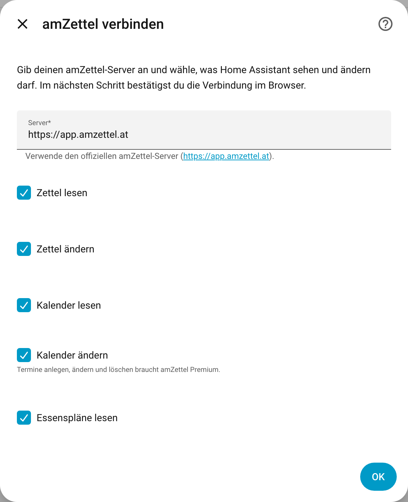

Mit **OK** fortfahren. Noch wurde keine bestehende Anmeldung verändert.

### 3. Den Device-Link öffnen

HA zeigt einen **Device-Code und einen Link**. Lass dieses HA-Fenster geöffnet und öffne
den Link in einem weiteren Tab oder auf deinem Telefon. Der Link enthält den Device-Code
bereits. Falls der Anmeldedienst stattdessen danach fragt, übertrage genau den von HA gezeigten Code.

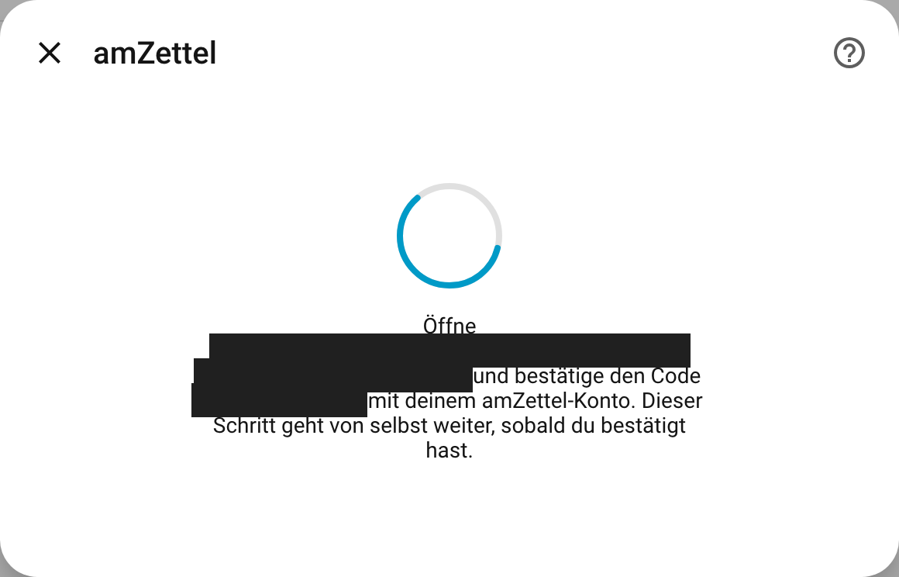

> [!IMPORTANT]
> **Device-Code und E-Mail-Anmeldecode sind zwei verschiedene Codes.** Der Device-Code ordnet
> die neue HA-Verbindung zu. Der gegebenenfalls anschließend per E-Mail angeforderte Code
> meldet dich an deinem Konto an. Trage nicht den Device-Code in das E-Mail-Codefeld ein.

Der Device-Code ist zeitlich begrenzt. Läuft er ab, den Vorgang in HA neu starten und den
neuen Link verwenden. Codes und vollständige Device-Links nicht an andere weitergeben.

### 4. Bei amZettel anmelden

Der Link führt zur **amZettel-Anmeldeseite**, bereitgestellt von Modgud auf
`amzettel.auth.cocoar.dev`.
Du gibst deinen E-Mail-Anmeldecode **dort** ein oder verwendest einen Passkey,
niemals im HA-Integrationsdialog.
Eine bestehende Modgud-Sitzung kann diesen Anmeldeschritt überspringen.

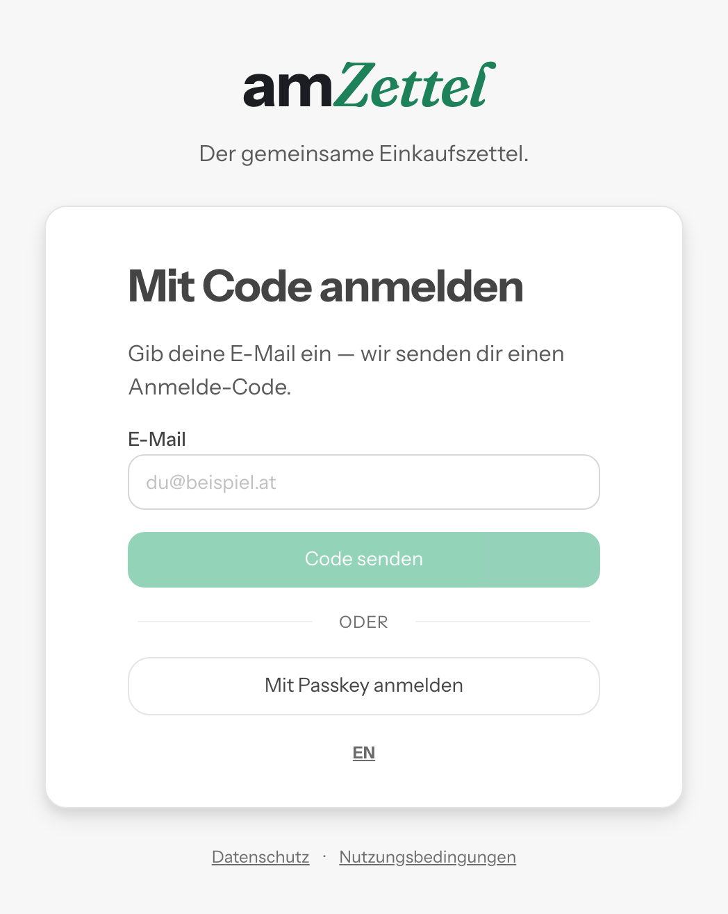

Die amZettel-Seite zeigt direkt **Mit Code anmelden**. Gib für den gezeigten
E-Mail-Weg deine eigene Kontoadresse ein und drücke **Code senden**.
Alternativ steht **Mit Passkey anmelden** zur Verfügung.

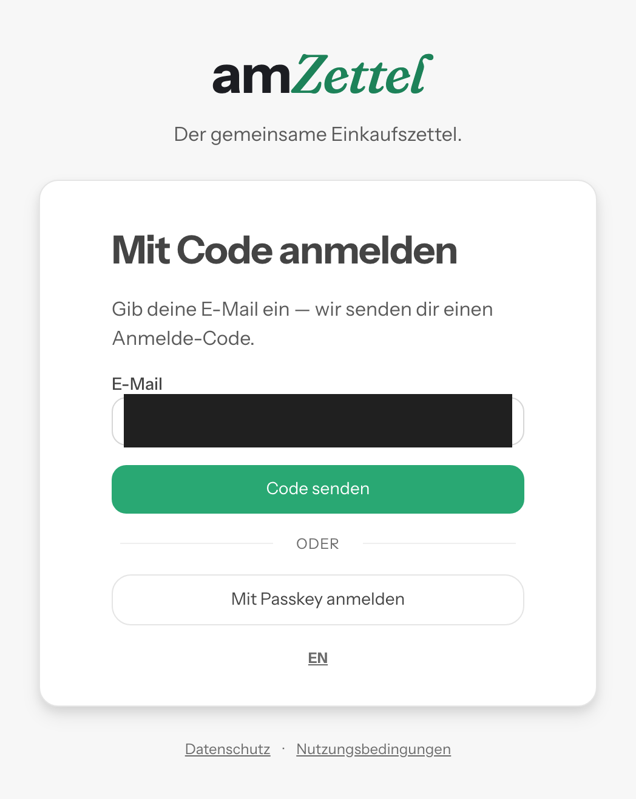

Den erhaltenen **E-Mail-Anmeldecode** in die sechs Felder eintragen und **Anmelden** wählen.
Die Aufnahme zeigt bewusst leere Codefelder. Verwende deine eigenen Zugangsdaten,
nicht das Beispielkonto aus den Bildern.

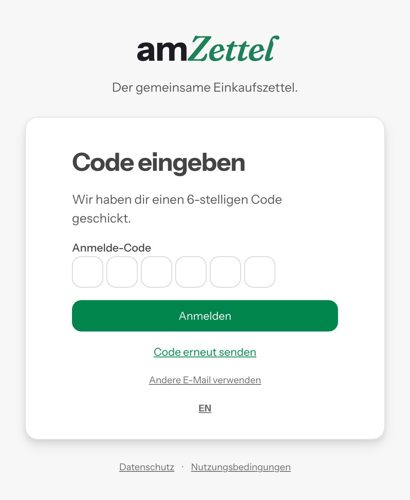

### 5. Zugriff prüfen und erlauben

Nach der Anmeldung folgt die **Gerätefreigabe** mit **Home Assistant verbinden?**
und den angefragten Rechten. Diese Seite sieht anders aus als die amZettel-Anmeldemaske;
sie fragt keine weiteren Zugangsdaten ab.
Prüfe, ob du diese Verbindung gerade selbst gestartet hast und ob die Rechte zu deiner
Auswahl in HA passen. **Erlauben** bestätigt die Verbindung; **Ablehnen** gibt keinen Zugriff frei.

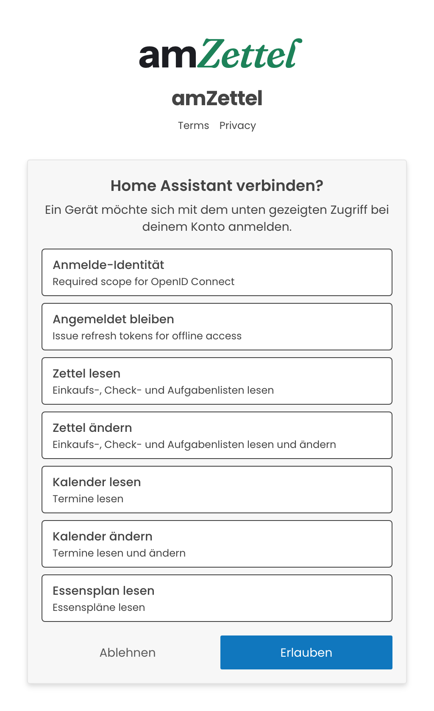

`openid` ist die OAuth-Anmeldung. `offline_access` erlaubt HA, Zugangstokens selbst
zu erneuern; es verlangt keine dauerhaft geöffnete Browserseite. Diese beiden Rechte
werden im gezeigten Consent auf Englisch beschrieben. Die übrigen Rechte betreffen
die ausgewählten amZettel-Bereiche.
Eine Bestätigung hebt weder Tarifgrenzen noch Objektberechtigungen auf.

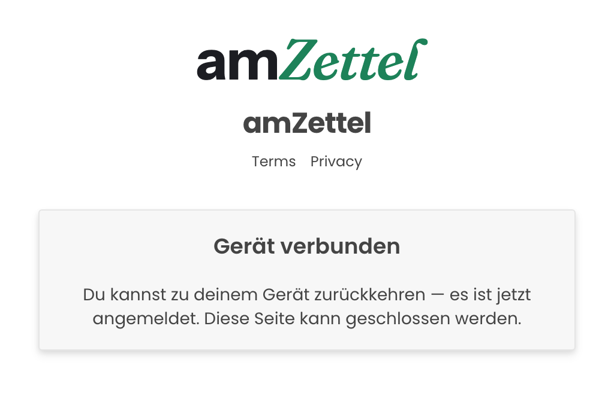

Nach **Gerät verbunden** zu HA zurückkehren. Kein Token muss kopiert werden.
HA braucht weder API-Schlüssel noch OAuth-Client-Secret oder eine öffentliche Internetadresse.
Die Verbindung erscheint in amZettel unter **Profil → Verbundene Systeme**.

### 6. Sichtbare Objekte auswählen

HA fährt automatisch mit **Was soll erscheinen?** fort. Wähle die gewünschten Zettel,
Kalender und Essenspläne. Optional einzelne benannte Kategorien als eigene Kalender auswählen.
**Neue Zettel/Kalender/Essenspläne automatisch übernehmen** bestimmt, ob spätere neue Objekte
von selbst hinzukommen. Die Auswahl ändert keine Daten in amZettel.

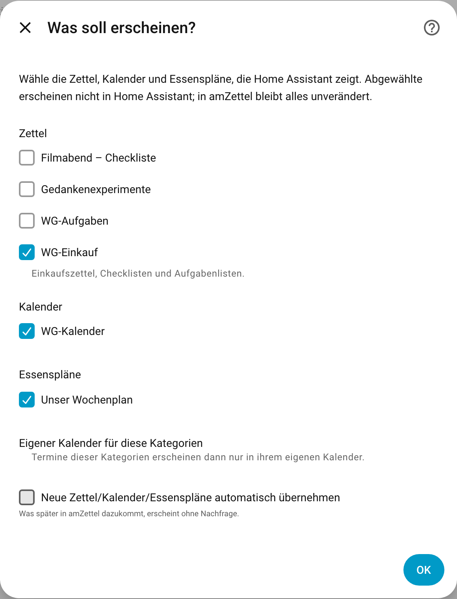

Mit **OK** speichern. Die Einrichtung bestätigt den Erfolg; die Entitäten erscheinen ohne
weiteren Neustart.

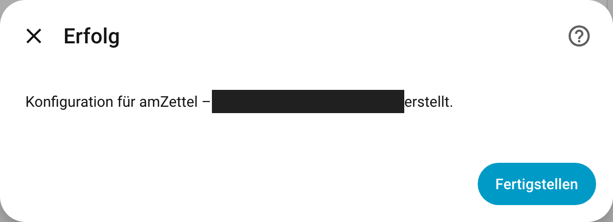

### 7. Konto und Verbindung kontrollieren

Unter **Einstellungen → Geräte & Dienste → amZettel** stehen nun das angemeldete Konto
und die ausgewählten Entitäten. Ein selbst vergebener Eintragstitel
bleibt erhalten; **Konfigurieren** zeigt das Konto trotzdem an.

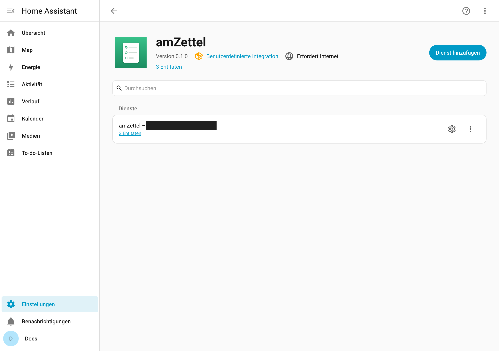

Es wird bewusst kein separates amZettel-Gerät angelegt. Ein Kalenderzustand `off` bedeutet
„gerade kein Termin aktiv“, nicht „Verbindung kaputt“.

## Nach dem Verbinden praktisch prüfen

1. Unter **To-do-Listen** einen ausgewählten Zettel öffnen und einen eigenen Testeintrag ergänzen.
2. Unter **Kalender** die gewünschten amZettel-Kalender einblenden.
3. In der amZettel-App mit **demselben Konto und derselben Umgebung** einen eigenen Testtermin
   anlegen. Er sollte in HA ohne manuelles Neuladen erscheinen.
4. Den Termin in HA öffnen, **Termin bearbeiten** wählen und Beginn/Ende ändern.
   Anschließend die gespeicherte Zeit in amZettel kontrollieren.
5. Eine geplante Mahlzeit öffnen: Ohne gespeicherte Uhrzeit erscheint sie ganztägig,
   wie in den aktuellen Prod-Aufnahmen. Falls Mahlzeiten-Uhrzeiten in amZettel verfügbar sind,
   muss eine mit Uhrzeit gespeicherte Mahlzeit zeitgebunden erscheinen.

Den bebilderten Ablauf zum [Verschieben von Terminen](configuration.md#termine-verschieben-und-abgleichen)
und den [Essensplan](configuration.md#essensplan) findest du in der Bedienung.
Weitere Beispiele stehen unter [Automationen](examples.md) und [Fehlerhilfe](troubleshooting.md).

## Aktualisieren

- **Marketplace/HACS:** angebotene Aktualisierung installieren und anschließend HA neu starten.
- **Manuell:** Backup erstellen, den Integrationsordner durch die neue Version ersetzen und HA
  neu starten. Nicht den restlichen HA-Konfigurationsordner ersetzen.
- Auswahl und Anmeldung bleiben bei normalen Updates erhalten. Fordert HA eine Neuanmeldung,
  folge dem angezeigten Dialog.
- Marketplace-/HACS-Updates nicht mit manuellem Kopieren mischen.

## Rechte ändern

**Konfigurieren** ändert die sichtbaren Objekte, nicht die bei der Anmeldung angeforderten Rechte.
Neue Bereiche oder zusätzliche Schreibrechte benötigen derzeit ein Entfernen und erneutes
Hinzufügen der Integration.

Vorher die Auswahl, Kategorie-Kalender und Entitäts-IDs notieren.
Prüfe anschließend die Ziele in Dashboards, Skripten, Automationen und Node-RED:
Beim Entfernen und erneuten Hinzufügen können Entitätszuordnungen verloren gehen.
Eine bloße Neuanmeldung nach einem Widerruf ist dagegen kein Entfernen der Integration.

> [!WARNING]
> Wer `sync_events` verwendet, sollte die Integration nicht als normalen Update-Schritt entfernen:
> Beim Entfernen geht deren lokale Herkunftszuordnung verloren. Vorhandene Termine bleiben in
> amZettel, ein späterer Abgleich kann alte, nicht mehr gelieferte Termine dann nicht mehr als seine
> eigenen erkennen. Siehe [Synchronisation](actions.md#amzettelsync_events).

## Verbindung sperren oder entfernen

- **Zugriff sofort entziehen:** In amZettel **Profil → Verbundene Systeme** die Verbindung sperren
  bzw. widerrufen. HA verlangt daraufhin eine Neuanmeldung. Nicht erneut bestätigen, wenn du die
  Verbindung nicht mehr möchtest.
- **Aus HA entfernen:** Bei **Einstellungen → Geräte & Dienste → amZettel** den betreffenden
  Eintrag löschen. Die Integration versucht dabei, ihren Refresh-Token zu widerrufen.
- **Vollständig deinstallieren:** Zuerst den Eintrag entfernen, danach über Marketplace/HACS deinstallieren
  oder den Ordner `/config/custom_components/amzettel` löschen und HA neu starten.

Zettel, Termine und Essenspläne in amZettel werden dadurch **nicht** gelöscht. Automationen mit
entfernten HA-Entitäten musst du selbst anpassen.

## Offizielle Hinweise

- [Benutzerdefinierte HACS-Repositories][custom]
- [Marketplace-Installation und Custom Repositories][marketplace]
- [Von HACS zu Marketplace wechseln][migration]
- [Dateistruktur von HA-Integrationen][structure]

[custom]: https://www.hacs.xyz/docs/faq/custom_repositories/
[marketplace]: https://www.home-assistant.io/integrations/marketplace/
[migration]: https://www.hacs.xyz/docs/marketplace/
[structure]: https://developers.home-assistant.io/docs/creating_integration_file_structure/
