# Installation and connection

**English** · [Deutsch](de/installation.md)

[Documentation overview](README.md)

**Steps:** [Requirements](#requirements) → [Install](#installation) →
[Connect to amZettel](#set-up-the-connection) → [Verify](#check-the-connection-in-practice).

## Requirements

- **Home Assistant 2026.10.0 or newer**, as specified in `hacs.json`.
- An **amZettel account**. The free plan is enough to read data and edit lists;
  editing calendar events requires Premium.
- Home Assistant and your browser can reach the amZettel server and its sign-in service.
- Administrator access to Home Assistant to install an integration.
- For installation through Marketplace/HACS: access to its repository management.

This is a **custom integration**, not an add-on. It runs inside Home Assistant;
you do not need an additional amZettel container. Manual installation works with
Home Assistant Container as well as Home Assistant OS.

## Installation

Choose the route for your Home Assistant version:

| HA version | Installation route |
|---|---|
| **2026.11 or newer** | [Marketplace](#marketplace), built in and recommended |
| **2026.10** | [HACS](#install-with-hacs), installed separately |
| **2026.10 or newer** | [Manual installation](#manual-installation), if preferred |

Marketplace and HACS install the same integration. Neither route requires inclusion in
the official catalog: you can add the GitHub repository yourself.
Community integrations are not reviewed or supported by the Home Assistant project.

### Marketplace

On **HA 2026.11 or newer**, Marketplace replaces HACS and is already included in HA.
Do not install HACS separately.

1. Open **Settings → Marketplace**.
2. On first use, read and acknowledge the warning about community content.
3. Choose **Add from link** and connect GitHub if prompted. HA displays a device code
   and a GitHub link: open the link, enter that code if needed and approve the connection.
   Return to HA when GitHub confirms success.
4. Under **GitHub link**, enter
   `https://github.com/cocoar-dev/amzettel-homeassistant` and choose **Add**.
   If asked for a content type, select **Integration** and choose **Add** again.
5. Open **amZettel**, choose **Install**, review the offered version and confirm **Install**.
6. Marketplace opens the amZettel setup dialog when installation completes. Continue with
   [server and permissions](#2-choose-the-server-and-permissions).
   If HA asks for a restart, restart it first. If the dialog does not open, use
   **Settings → Devices & services → Add integration → amZettel**.

> [!NOTE]
> The GitHub connection lets Marketplace download and update the custom repository.
> It does **not** sign you in to amZettel. The amZettel device code and account approval
> described below belong to a separate connection.

The installed integration in Marketplace on HA 2026.11.2 (cropped view):

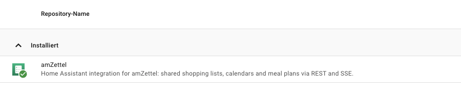

This genuine screenshot uses the German interface; **Installiert** means **Installed**.

### Install with HACS

For **HA 2026.10** with HACS already configured:

1. Open **HACS**.
2. Under **⋮ → Custom repositories**, enter
   `https://github.com/cocoar-dev/amzettel-homeassistant`.
3. Select **Integration** as the type and add it.
4. Search for **amZettel** and download the offered version.
5. **Restart Home Assistant**, not just the browser page.
6. Then [set up the connection](#set-up-the-connection).

For a placeholder icon in the HACS list, see the [brand image notes](branding.md#integration-and-validation).

### Upgrading from HACS

When you upgrade HA to **2026.11 or newer**, Marketplace automatically takes over from HACS.
Installed content, custom repositories and update entities are retained; HACS itself is removed.
Open **Settings → Marketplace** afterwards. You do not need to uninstall amZettel,
copy its files again or recreate its connection.
See the [official HACS migration guide][migration] for other changes.

## Manual installation

1. Create a Home Assistant backup.
2. Take the **`custom_components/amzettel`** folder from this repository.
3. Copy the **entire folder** into your Home Assistant configuration directory:
   under `custom_components/amzettel`.
4. **Restart Home Assistant.**
5. [Set up the connection](#set-up-the-connection).

The configuration directory is the folder containing `configuration.yaml`.
On HA OS it is typically `/config`. In a container, `/config` maps to the host directory
mounted by the operator.

For example, the manifest should end up here:

```text
/config/custom_components/amzettel/manifest.json
```

**Not** under `/config/amzettel` or
`/config/custom_components/amzettel/custom_components/amzettel`.
Do not copy `.local`, old `.venv` directories, tests or Git files into `/config`.
The `brand` and `translations` subfolders must be included.

For a **first installation with file access to the HA host**, you can copy from the extracted
source/installation folder as follows. Replace the example path with your actual configuration
directory:

```sh
HA_CONFIG="/path/to/ha-configuration"
mkdir -p "$HA_CONFIG/custom_components"
cp -R custom_components/amzettel "$HA_CONFIG/custom_components/"
```

Using a file manager or an existing share, copy the entire folder in the same way.
For an update, follow [Updates](#updates) instead.

### With an existing HA container

Copy the integration folder into the configuration directory your existing container already mounts.
Alternatively, add a bind mount at `/config/custom_components/amzettel`.

The integration needs no changes to `configuration.yaml`. There is no need to reinstall HA,
reset its configuration directory or delete existing containers.

## Set up the connection

These **genuine screenshots** were captured with HA 2026.10.4 and a dedicated demo account on
`app.amzettel.at`. The example objects are `WG-Einkauf`, `WG-Kalender` and `Unser Wochenplan`.
Account addresses, access codes and complete device links are covered.
Demo object names stay German; the interface is English.

### 1. Find the integration

Open **Settings → Devices & services → Add integration**, search for **amZettel** and select it.
If Marketplace has already opened the setup dialog, continue with step 2 instead.
If it is missing, check the [installation path](#manual-installation) and restart HA completely.

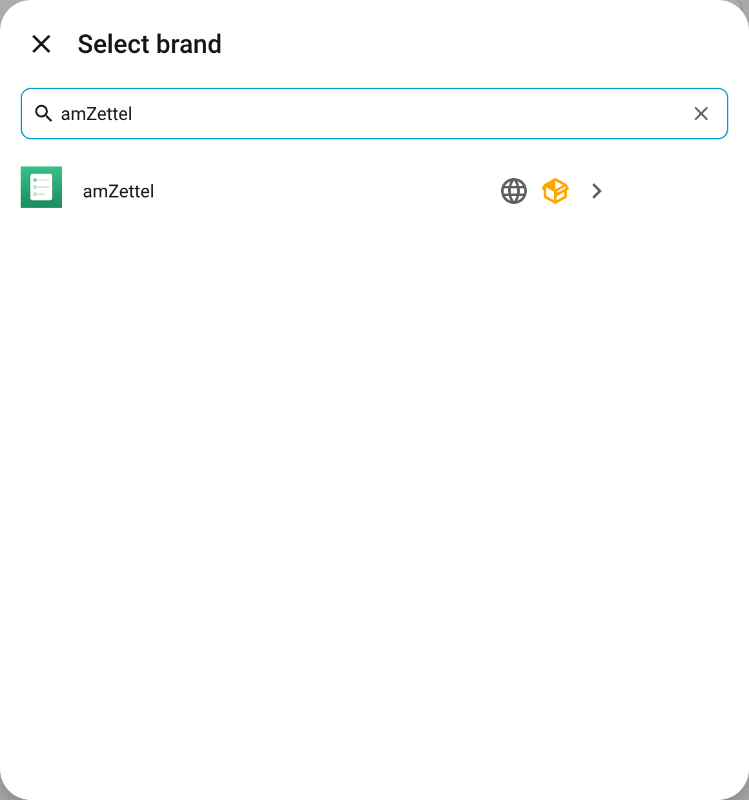

### 2. Choose the server and permissions

Keep the default official server, `https://app.amzettel.at`, and select the permissions
Home Assistant needs. HA uses **REST/SSE v1** exclusively.
To move events later, enable **Change calendars**. Premium, object membership and the access
granted in amZettel also apply. See the [permission overview](configuration.md#which-permissions-does-ha-need).

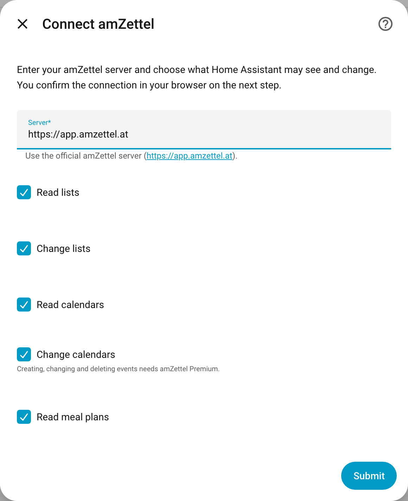

Choose **Submit**. No existing sign-in has been changed at this point.

### 3. Open the device link

HA displays a **device code and a link**. Keep this HA window open and open the link in another
tab or on your phone. The link already contains the device code. If the sign-in service asks
for it separately, enter exactly the code shown by HA.

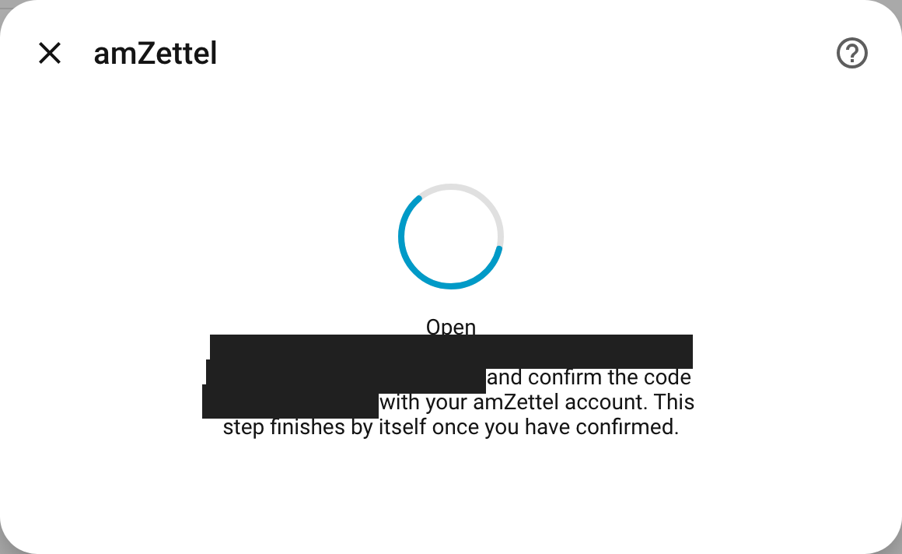

> [!IMPORTANT]
> **The device code and e-mail sign-in code are different codes.** The device code identifies
> the new HA connection. An e-mail code requested afterwards signs you in to your account.
> Do not enter the device code into the e-mail-code fields.

The device code expires. If it does, restart the flow in HA and use the new link.
Do not share codes or complete device links with anyone else.

### 4. Sign in to amZettel

The link opens the **amZettel sign-in page**, provided by Modgud at
`amzettel.auth.cocoar.dev`.
Enter your e-mail sign-in code **there**, or use a passkey, never in the HA integration dialog.
An existing Modgud session may skip this sign-in step.

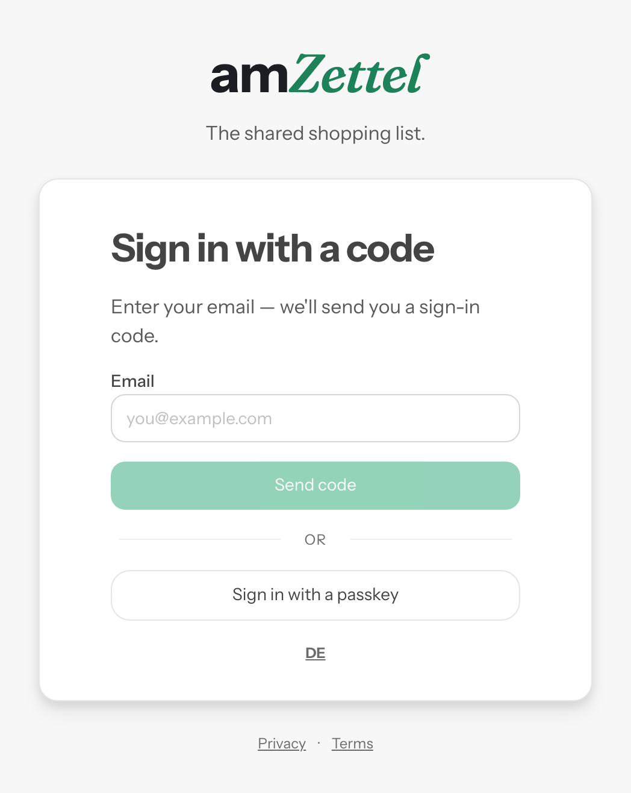

The amZettel page directly shows **Sign in with a code**. For the e-mail route shown
here, enter your own account address and choose **Send code**.
Alternatively, **Sign in with a passkey** is available.

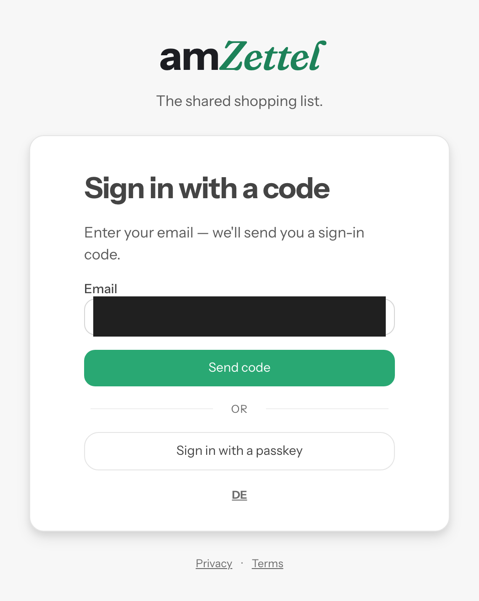

Enter the received **e-mail sign-in code** into the six fields and choose **Sign in**.
The screenshot intentionally shows empty code fields. Use your own credentials,
not the example account shown in the images.

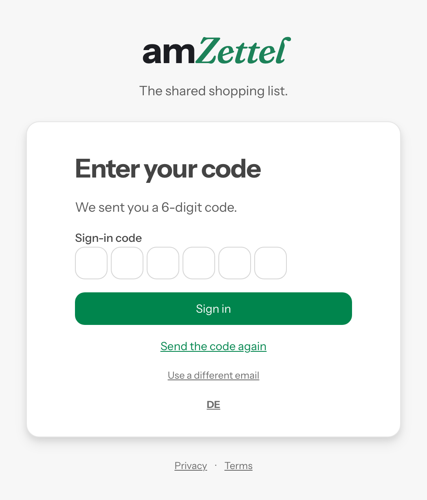

### 5. Review and approve access

After sign-in, the **device approval** page shows **Connect Home Assistant?**
and the requested permissions. This page looks different from the amZettel sign-in form;
it does not ask for additional credentials.
Check that you started this connection yourself and that the permissions match your HA choices.
**Allow** approves the connection; **Deny** does not grant access.

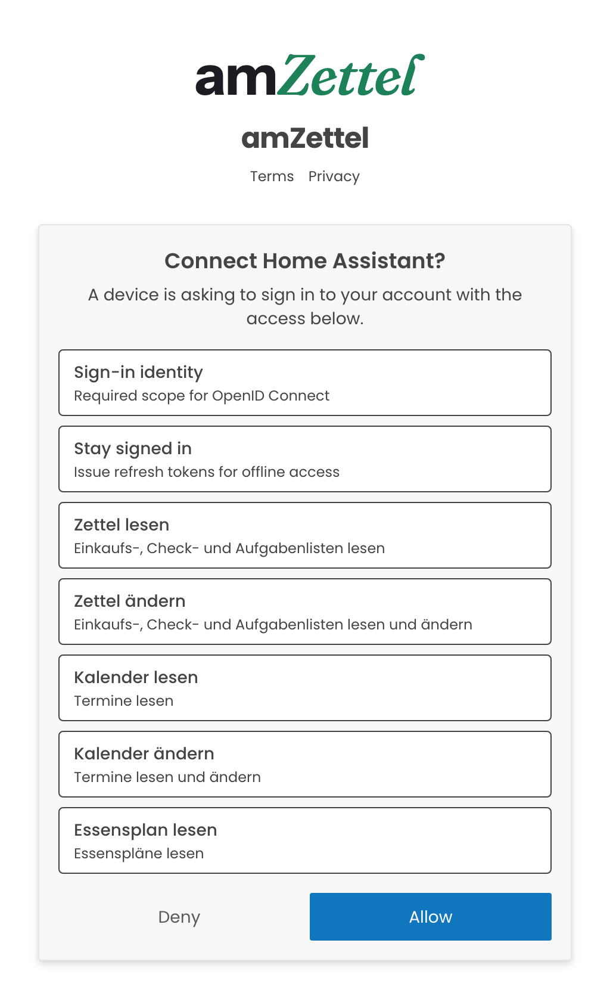

`openid` is the OAuth sign-in. `offline_access` allows HA to renew access tokens
automatically; you do not have to keep the browser page open.
Approval does not override subscription or object-access restrictions.

> [!NOTE]
> In the captured production flow, the amZettel-specific permission names remain German even
> on the English consent screen. These are the real service labels, not translated screenshot text:
> **Zettel lesen/ändern** = read/change lists; **Kalender lesen/ändern** = read/change calendars;
> **Essensplan lesen** = read meal plans. The surrounding Modgud interface is English.

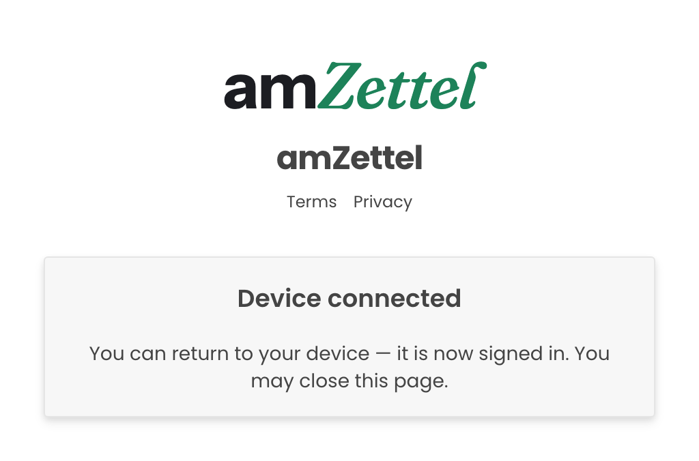

After **Device connected**, return to HA. You do not copy a token.
HA needs no API key, OAuth client secret or public internet address.
The connection appears in amZettel under **Profile → Connected systems**.

### 6. Select visible objects

HA automatically continues to **What should appear?**. Select the lists, calendars and meal
plans you want. Optionally select named categories to expose as separate calendars.
**Add new lists, calendars and meal plans automatically** controls whether later objects appear
without another selection. This does not change any data in amZettel.

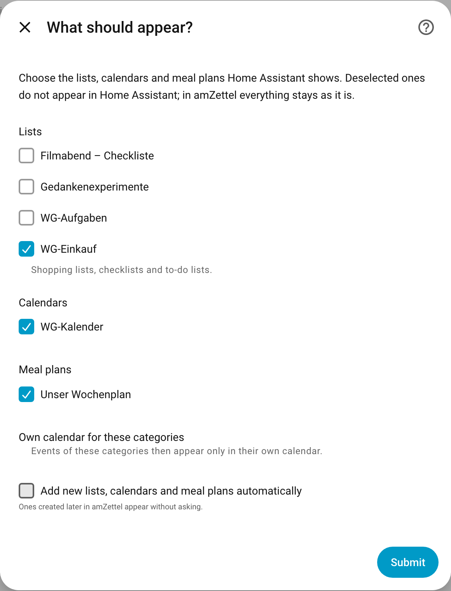

Choose **Submit**. Setup confirms success; the entities appear without another restart.

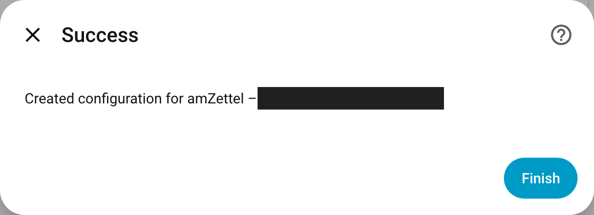

### 7. Check the account and connection

Under **Settings → Devices & services → amZettel**, the entry identifies the signed-in account
and selected entities. Custom entry titles are preserved;
**Configure** still shows the account.

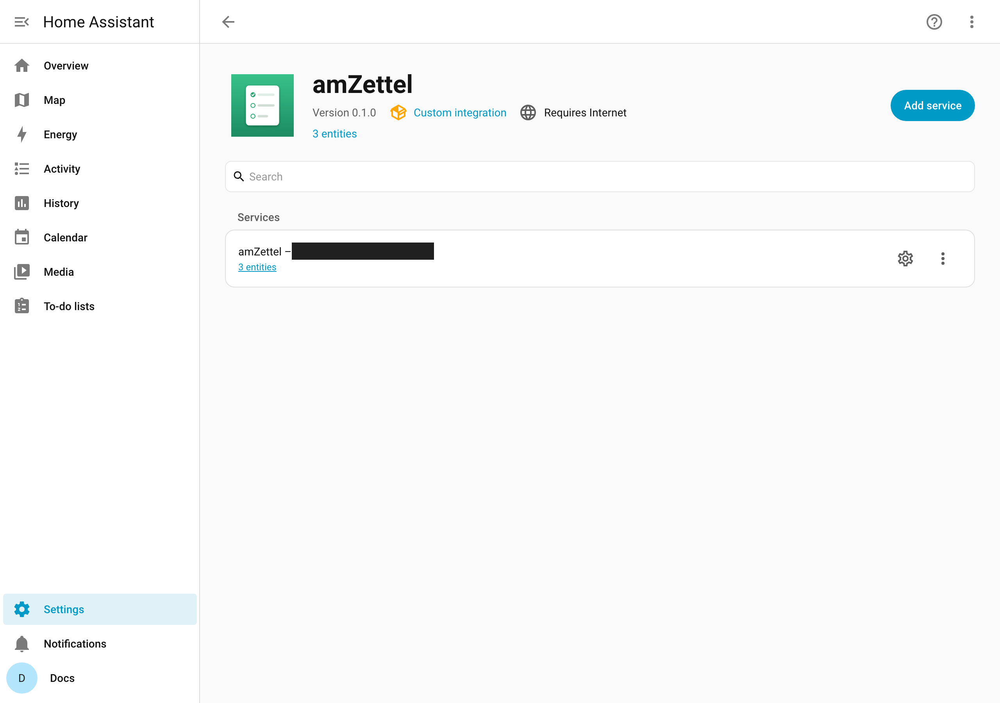

The integration deliberately creates no separate amZettel device. A calendar state of `off`
means “no event is currently active,” not “the connection is broken.”

## Check the connection in practice

1. Open a selected list under **To-do lists** and add your own test item.
2. Enable the relevant amZettel calendars under **Calendar**.
3. In the amZettel app, using **the same account and environment**, create your own test event.
   It should appear in HA without a manual refresh.
4. Open the event in HA, choose **Edit event** and change its start/end.
   Then check the stored time in amZettel.
5. Open a planned meal: without a stored clock time, it appears all-day,
   as in the current production screenshots. If meal times are available in amZettel,
   a meal saved with a clock time must appear as timed.

See the illustrated [event-editing walkthrough](configuration.md#move-events-and-check-synchronization)
and [meal plans](configuration.md#meal-plans) in the usage guide.
Continue with [automation examples](examples.md) or [troubleshooting](troubleshooting.md).

## Updates

- **Marketplace/HACS:** install the offered update and restart HA.
- **Manual:** create a backup, replace the integration folder with the new version, and restart HA.
  Do not replace the rest of the HA configuration directory.
- Normal updates preserve your selection and sign-in. If HA asks you to sign in again,
  follow the displayed flow.
- Do not combine Marketplace/HACS updates with manual copying.

## Change permissions

**Configure** changes visible objects, not the permissions requested during sign-in.
Additional areas or write permissions currently require removing and adding the integration again.

First note your selections, category calendars and entity IDs.
Afterwards, check targets in dashboards, scripts, automations and Node-RED:
removing and adding the integration again can lose entity mappings.
Signing in again after revocation is different from removing the integration.

> [!WARNING]
> If you use `sync_events`, do not remove the integration as part of a normal update:
> removal discards its local source-ownership mapping. Existing events remain in amZettel,
> but a later synchronization cannot recognize old events no longer supplied as its own.
> See [synchronization](actions.md#amzettelsync_events).

## Revoke or remove the connection

- **Withdraw access immediately:** in amZettel, revoke or block the connection under
  **Profile → Connected systems**. HA then requests reauthentication. Do not approve it again
  if you no longer want the connection.
- **Remove it from HA:** delete the relevant entry under **Settings → Devices & services → amZettel**.
  The integration attempts to revoke its refresh token.
- **Uninstall completely:** first remove the entry, then uninstall through Marketplace/HACS or delete
  `/config/custom_components/amzettel`, and restart HA.

This does **not** delete lists, events or meal plans in amZettel.
Update any automations that reference removed HA entities yourself.

## Official references

- [Custom HACS repositories][custom]
- [Marketplace installation and custom repositories][marketplace]
- [Moving from HACS to Marketplace][migration]
- [HA integration file structure][structure]

[custom]: https://www.hacs.xyz/docs/faq/custom_repositories/
[marketplace]: https://www.home-assistant.io/integrations/marketplace/
[migration]: https://www.hacs.xyz/docs/marketplace/
[structure]: https://developers.home-assistant.io/docs/creating_integration_file_structure/
