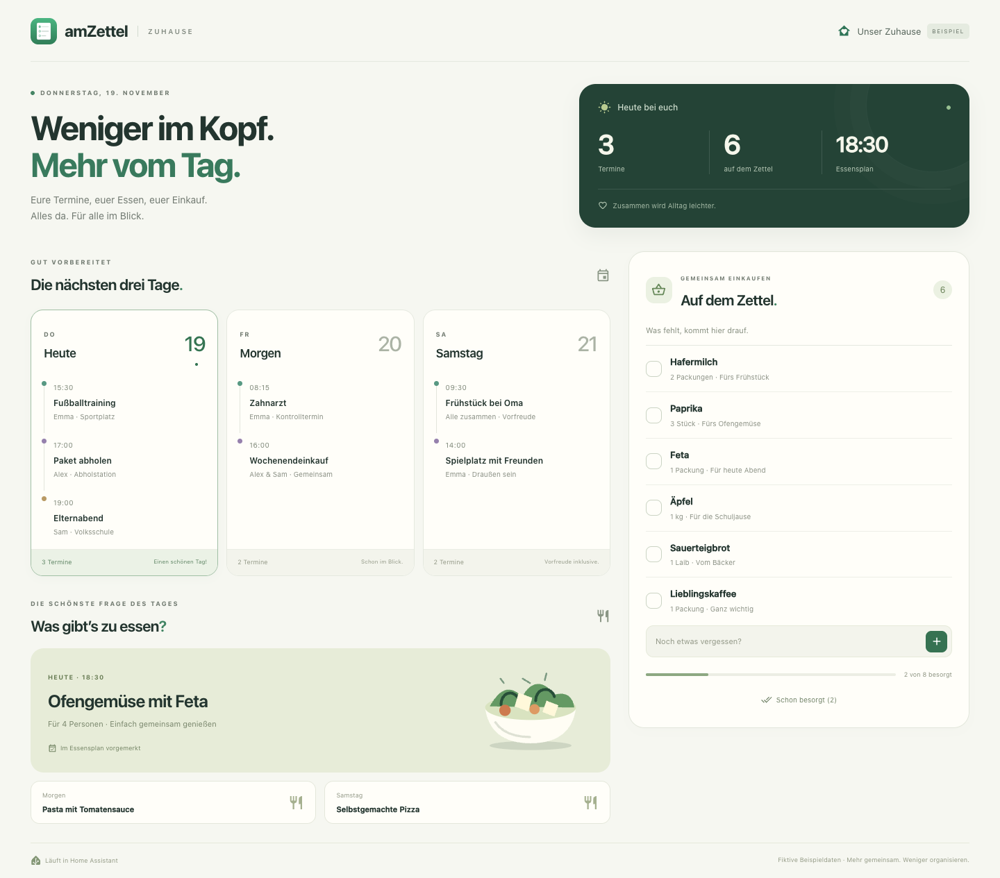

# Ein Zuhause-Dashboard zum Nachbauen

[English](README.md) · **Deutsch** · [Integration](../../README.de.md)

Eine optionale, anpassbare Lovelace-Vorlage: drei Tage mit Terminen, Essensplan und
gemeinsamem Einkaufszettel. Sie läuft **in Home Assistant**, nicht auf einem
zusätzlichen Webserver. Keine weiteren Community-Karten, npm-Pakete, externen
Schriften oder Cloud-Schlüssel nötig.



Die Vorschau zeigt fiktive lokale Beispieldaten. **Nur die Oberfläche wird
übersetzt**: Termine, Rezepte, Einkaufsartikel und Notizen behalten die Sprache
deiner Daten. [Englische Vorschau](preview.png). Das Datum im Screenshot ist der
Aufnahmestand; die Vorlage verwendet das aktuelle Datum.

## 1. Daten verbinden

Die [amZettel-Integration installieren und anmelden](../../docs/de/installation.md).
Die eigenen Entitäts-IDs findest du unter **Einstellungen → Geräte & Dienste →
Entitäten**:

| Option | Entität | Zweck |
|---|---|---|
| `calendar` | `calendar.…` | Haushaltstermine |
| `meals` | `calendar.…` | Essensplan-Kalender |
| `shopping` | `todo.…` | Einkaufszettel |

Die IDs in den YAML-Beispielen sind Platzhalter. Die Vorlage legt keine Daten und
kein Konto an. Kalender und Essensplan können nur lesend freigegeben werden;
zum Ergänzen und Abhaken des Einkaufszettels sind Schreibrechte nötig.
Freigegebene Rechte und Free-/Premium-Grenzen der Integration gelten weiterhin.

## 2. Karte kopieren

Im HA-Konfigurationsverzeichnis `/config/www/amzettel-household/` anlegen.
Mit deinem üblichen Dateieditor, Samba- oder SSH-Zugang diese Dateien hineinkopieren:

- `amzettel-household-card.mjs`
- `amzettel-household-model.mjs`
- `icon.png` aus [`custom_components/amzettel/brand/`](../../custom_components/amzettel/brand/icon.png)
  (auch in der installierten Integration vorhanden)

Tests, Vorschauen und lokale Laufzeitdateien gehören **nicht** nach HA.
Dateien unter `www/` sind öffentlich abrufbar; dort niemals Zugangsdaten oder HA-Speicherdateien ablegen.
Wenn du `www/` erstmals angelegt hast, HA einmal neu starten, damit die
`/local/`-Adresse verfügbar wird.

## 3. Ressource registrieren

Bei über die Oberfläche verwalteten Dashboards unter **Einstellungen →
Dashboards → Ressourcen** eine Ressource hinzufügen. Falls nötig, vorher den
erweiterten Modus im eigenen Profil einschalten:

```text
URL: /local/amzettel-household/amzettel-household-card.mjs?v=1
Typ: JavaScript-Modul
```

Wenn du Dashboard-Ressourcen bereits über YAML verwaltest, stattdessen in die
vorhandene Konfiguration integrieren:

```yaml
lovelace:
  resource_mode: yaml
  resources:
    - url: /local/amzettel-household/amzettel-household-card.mjs?v=1
      type: module
```

Den bisherigen Dashboard-Modus und andere Ressourcen beibehalten. `resource_mode`
steuert nur die Ressourcen und verlangt keinen Wechsel der Dashboards zu YAML.
In diesem Modus Ressourcen über `lovelace.reload_resources` neu laden oder HA neu
starten. Die Karte nicht doppelt registrieren und keinen vorhandenen
`lovelace:`-Abschnitt ersetzen.

## 4. Theme und Dashboard hinzufügen

Die Karte bringt ihr eigenes Design mit. Für die passende HA-Umgebung `theme.yaml`
in den vorhandenen Themes-Ordner kopieren. Falls noch keine Themes geladen werden:

```yaml
frontend:
  themes: !include_dir_merge_named themes
```

Die Datei als `/config/themes/amzettel-household.yaml` speichern. Andere
Frontend-Einstellungen behalten und keinen zweiten `frontend:`-Abschnitt anlegen.
Themes neu laden oder HA neu starten. Ohne Theme kannst du
`theme: amZettelHousehold` aus der Dashboard-Vorlage entfernen.

Ein **neues** Dashboard anlegen und im Rohkonfigurationseditor
[`dashboard.de.yaml`](dashboard.de.yaml) oder [`dashboard.yaml`](dashboard.yaml)
einfügen. Die drei Entitäts-IDs ersetzen. `household: ""` verwendet einen passenden
Standardnamen; alternativ den eigenen Haushaltsnamen eintragen.
`language: de` oder `language: en` schaltet nur die Oberfläche um, nicht die
amZettel-Inhalte.

## Verhalten und Anpassungen

- Datumsanzeigen verwenden die HA-Zeitzone. Die Agenda zeigt heute und die beiden
  folgenden Tage.
- Im Essensbereich erscheint die **erste geplante Mahlzeit je Tag**. Ein Frühstück
  wird nicht als Abendessen ausgegeben. Ohne gespeicherte Uhrzeit steht dort
  „Geplant“; Uhrzeit und Dauer werden nicht erfunden. Mahlzeiten sind hier nicht
  bearbeitbar.
- Einkaufsaktionen verwenden die normalen HA-To-do-Aktionen. Am Desktop scrollt
  die Liste in der Karte, am Handy stehen die Karten und Einträge untereinander.
- `demo: true` blendet eine Beispieldaten-Kennzeichnung ein; für den eigenen
  Haushalt weglassen.
- Oberflächentexte stehen in den `COPY`-Wörterbüchern des Modells, Farben und
  Layout im `styles`-Block der Karte. Die eigene Kopie darf als Basis dienen.
- Das ist ein optionales Beispiel, kein automatisch installiertes Dashboard und
  kein visueller Dashboard-Editor. HACS-/Marketplace-Updates der Integration
  aktualisieren die manuell kopierten Frontend-Dateien nicht.

Beim Aktualisieren **beide** Module kopieren. Bei Codeänderungen eine neue,
übereinstimmende `?v=`-Version in Ressourcen-URL und Modellimport am Anfang der
Karte verwenden und den Browser neu laden. So umgehst du den langlebigen
`/local/`-Cache von HA.

## Fehlerhilfe und Tests

„Custom element doesn't exist“: beide Moduldateien und Ressourcen-URL prüfen,
Browser neu laden und die Konsole auf fehlende Module prüfen.
Fehlende Daten: Entitäts-IDs, Verfügbarkeit und freigegebene Rechte kontrollieren.
Fehlgeschlagene Schreibaktionen werden angezeigt; eine offene Eingabe bleibt erhalten.

Entwickler können die Tests ohne zusätzliche Pakete mit Node.js ab Version 22 ausführen:

```sh
node --test examples/dashboard/tests/*.test.mjs
```

Code und Dokumentation: [MIT](../../LICENSE).
Für das unveränderte Logo und Logos in Bildern gelten die [gesonderten Markenbedingungen](../../TRADEMARK.md).
