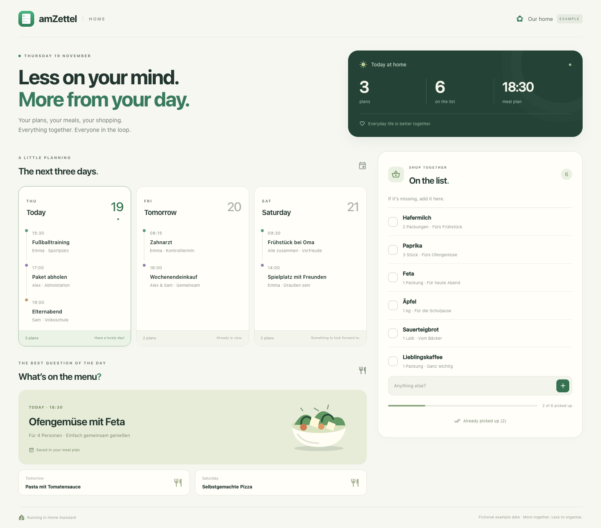

# A home dashboard to make your own

**English** · [Deutsch](README.de.md) · [Integration](../../README.md)

An optional, editable Lovelace dashboard: three days of plans, meals and a shared
shopping list. It runs **inside Home Assistant**, not on a separate web server.
No additional community cards, npm packages, external fonts or cloud keys.



The preview uses fictional local example data. **Only the interface is translated**:
event titles, recipes, shopping items and notes keep the language of your data.
[German preview](preview.de.png). Screenshots show the capture date, not a fixed
date in the template.

## 1. Connect your data

Install and connect the [amZettel integration](../../docs/installation.md).
Find your actual entity IDs under **Settings → Devices & services → Entities**:

| Option | Entity | Purpose |
|---|---|---|
| `calendar` | `calendar.…` | Household appointments |
| `meals` | `calendar.…` | Meal-plan calendar |
| `shopping` | `todo.…` | Shopping list |

The IDs in the YAML examples are placeholders. No data or account is created by
the template. Calendar and meal-plan access can remain read-only; adding or
completing shopping items needs write permission. Existing integration permissions
and Free/Premium limits still apply.

## 2. Copy the card

Create `/config/www/amzettel-household/` in your HA configuration directory.
Using your usual file editor, Samba or SSH access, copy these files there:

- `amzettel-household-card.mjs`
- `amzettel-household-model.mjs`
- `icon.png` from [`custom_components/amzettel/brand/`](../../custom_components/amzettel/brand/icon.png)
  (also present in the installed integration)

Do **not** copy the tests, screenshots or local runtime files into HA.
Files under `www/` are publicly downloadable; never put credentials or HA storage there.
If this is the first time you have created `www/`, restart HA once so the
`/local/` route becomes available.

## 3. Register the resource

For dashboards managed in the UI, add a resource under **Settings → Dashboards →
Resources** (enable Advanced mode in your profile if needed):

```text
URL: /local/amzettel-household/amzettel-household-card.mjs?v=1
Type: JavaScript module
```

If you already manage dashboard resources in YAML, merge this into your existing
configuration instead:

```yaml
lovelace:
  resource_mode: yaml
  resources:
    - url: /local/amzettel-household/amzettel-household-card.mjs?v=1
      type: module
```

Keep your existing dashboard mode and other resources. `resource_mode` controls
resources only; it does not require switching dashboards to YAML mode. In this
mode, reload resources with `lovelace.reload_resources` or restart HA. Do not
register the card twice or replace an existing `lovelace:` section.

## 4. Add the theme and dashboard

The card includes its own design. For matching HA chrome, copy `theme.yaml` into
your existing themes directory. If you do not load themes yet, merge:

```yaml
frontend:
  themes: !include_dir_merge_named themes
```

Save the file as `/config/themes/amzettel-household.yaml`. Keep any other frontend
settings; do not add a second `frontend:` section. Reload themes or restart HA.
You may omit `theme: amZettelHousehold` from the dashboard if you do not want it.

Create a **new** dashboard, open its raw configuration editor and paste
[`dashboard.yaml`](dashboard.yaml) or [`dashboard.de.yaml`](dashboard.de.yaml).
Replace the three entity IDs. `household: ""` uses the localized default name;
set your own household name if you prefer. `language: en` or `language: de`
switches the interface without changing your amZettel content.

## Behaviour and customization

- Dates follow HA's time zone. The agenda includes today and the next two days.
- The meal area shows the **first planned meal for each day**. It does not claim
  that a breakfast entry is dinner. A meal without a stored time says “Planned”;
  no time or duration is invented. Meals are not editable through this card.
- Shopping actions use standard HA to-do services. Desktop lists scroll inside
  the card; phone layouts stack and show all items.
- `demo: true` adds an example-data badge; omit it for your household.
- Text comes from the `COPY` dictionaries in the model; colours and layout are in
  the card's `styles` block. Edit your own copy to use this as a starting point.
- This is an optional example, not an automatically installed dashboard or a
  visual dashboard editor. HACS/Marketplace integration updates do not update
  manually copied frontend files.

When updating, copy **both** modules. If you change the code, use a fresh matching
`?v=` in the resource URL and the model import at the top of the card, then reload
the browser. This avoids HA's long-lived `/local/` cache.

## Troubleshooting and tests

“Custom element doesn't exist”: check both module files and the resource URL,
reload the browser and inspect its console for a missing module.
Missing data: check entity IDs, availability and the granted permissions.
Failed writes stay visible and preserve an unfinished input.

Developers can run the dependency-free tests with Node.js 22 or later:

```sh
node --test examples/dashboard/tests/*.test.mjs
```

Code and documentation: [MIT](../../LICENSE).
The unmodified logo and logos in screenshots have [separate brand terms](../../TRADEMARK.md).
